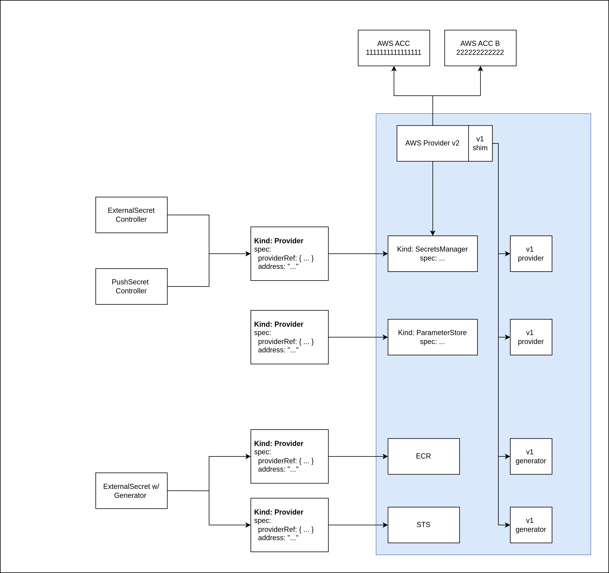
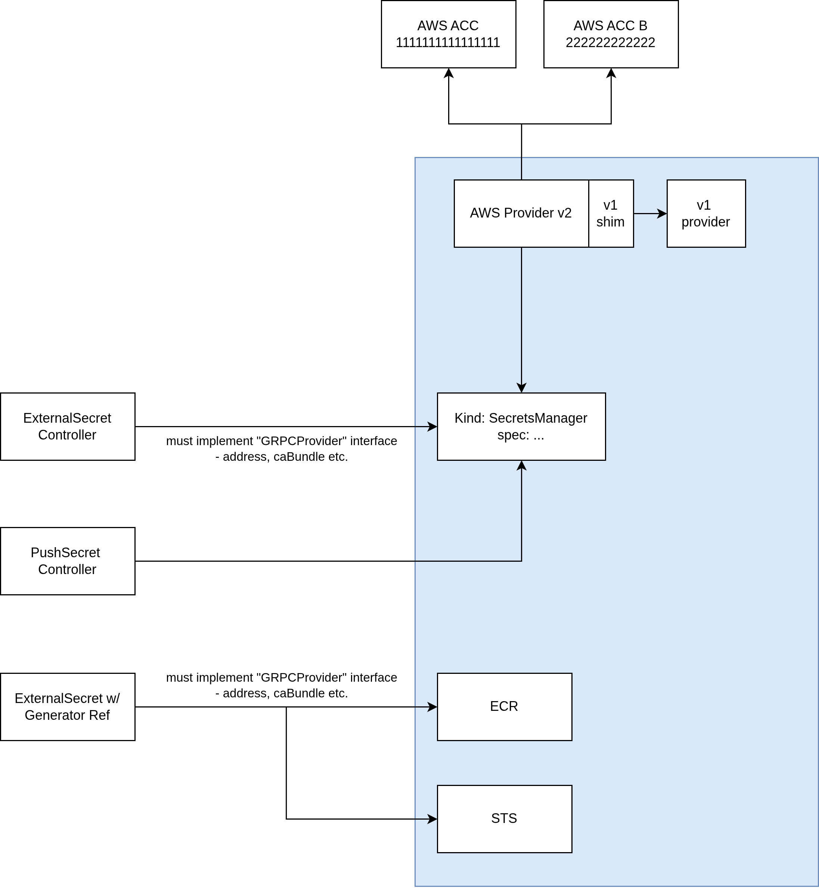

# API Design for Out-of-Process Providers

## Problem Description

How should `ExternalSecret` and `PushSecret` resources reference out-of-process providers?

How would the equivalent of `ClusterSecretStore` look like?

## Context

Out-of-process providers run in separate pods and communicate with ESO Core via gRPC. We need an API design that enables:

- Service discovery: ESO Core must locate the provider's gRPC endpoint
- Provider-specific configuration: Each provider needs its own configuration (credentials, endpoints, etc.)
- Cluster-scoped and namespace-scoped resources
- Common provider behaviors (authentication scope, conditions, status)

## Options

### Option 1: Provider Indirection Layer *(implemented by PoC 1, #5527; rejected)*

ExternalSecret references a `Provider` or `ClusterProvider` resource, which then references a provider-specific custom resource.

**Architecture:**
```
ExternalSecret
  ├─> secretStoreRef.kind: Provider
  └─> secretStoreRef.name: my-provider
        └─> Provider
              ├─> spec.address: grpc://provider-service:8080
              └─> spec.providerRef
                    ├─> kind: SecretsManager
                    └─> name: team-blue-eu-west-2
```



**Example:**
```yaml

apiVersion: external-secrets.io/v1
kind: ExternalSecret
metadata:
  name: database-credentials
  namespace: external-secrets-system
spec:
  refreshInterval: 1h
  secretStoreRef:
    kind: Provider
    name: aws-provider
```

**Pros:**
- Common fields and behaviors are defined once on `Provider`/`ClusterProvider`
- Service discovery is explicit via `spec.address`
- No need for cluster-scoped variants of provider-specific CRDs
- Clear separation: `Provider` handles connectivity, provider-specific CR handles configuration

**Cons:**
- Additional layer of indirection increases complexity
- Users must understand two resource types instead of one
- Naming and responsibilities may be unclear to new users
- More verbose configuration
- *(updated)* `Provider` duplicates what `SecretStore` already is (the thing an `ExternalSecret` points at). Every `ExternalSecret` has to change `secretStoreRef.kind`, and features that live on stores today (`conditions`, `controller`, `retrySettings`, `refreshInterval`, flood gate, PushSecret finalizers) must be re-implemented on `Provider`. This is why #5527 was closed in favour of #6245.

### Option 2: Direct Reference *(rejected)*

ExternalSecret directly references provider-specific custom resources.

**Architecture:**
```
ExternalSecret
  ├─> secretStoreRef.apiVersion: aws.provider.external-secrets.io/v2alpha1
  ├─> secretStoreRef.kind: SecretsManager
  └─> secretStoreRef.name: team-blue-eu-west-2
```



**Example:**

```yaml

apiVersion: external-secrets.io/v1
kind: ExternalSecret
metadata:
  name: database-credentials
  namespace: external-secrets-system
spec:
  refreshInterval: 1h
  secretStoreRef:
    apiVersion: aws.provider.external-secrets.io/v2alpha1
    kind: SecretsManager
    name: team-blue-eu-west-2

```

**Pros:**
- Simpler mental model: one reference instead of two
- Fewer resources to manage
- More intuitive for users familiar with Kubernetes patterns
- Cleaner YAML configuration

**Cons:**
- Each provider must implement cluster-scoped variants (e.g., `ClusterSecretsManager`, `ClusterParameterStore`)
- Significant boilerplate code for cluster-scoped resources
- Service discovery requires convention-based approach (e.g., labels on Service objects)
- Common fields must be duplicated across all provider CRDs
- No single place to configure authentication scope or shared behaviors
- ESO Core cannot interpret provider-specific fields

### *(new)* Option 3: Store-centric runtime split *(implemented by PoC 2/3, #6245 and #6710; adopted)*

`SecretStore` and `ClusterSecretStore` stay the objects that `ExternalSecret` and `PushSecret` reference. The store gains two optional references: *where* the provider runs (`runtimeRef`, a core-owned transport object) and *what* configuration it uses (`providerRef`, a provider-owned CRD). The inline `spec.provider` union remains for in-process providers and is mutually exclusive with the new references.

**Architecture:**
```
ExternalSecret / PushSecret                      (unchanged)
  └─> secretStoreRef: {kind: SecretStore, name: aws-prod}
        └─> SecretStore aws-prod
              ├─> spec.runtimeRef  ──> ProviderClass | ClusterProviderClass   (core-owned: endpoint, protocol, tls, auth, timeout)
              └─> spec.providerRef ──> <provider group>/<Kind> aws-prod       (provider-owned: region, auth, ...)
```

**Example:**
```yaml
apiVersion: external-secrets.io/v1
kind: SecretStore
metadata:
  name: aws-prod
  namespace: team-a
spec:
  runtimeRef:
    name: aws                      # ProviderClass in team-a (kind defaults to the store's scope)
  providerRef:
    apiVersion: provider.external-secrets.io/v1alpha1
    kind: SecretsManager
    name: aws-prod
```

**Pros:**
- `ExternalSecret` and `PushSecret` manifests do not change at all. Migration is an edit to the store.
- Everything that already lives on stores keeps working for out-of-process providers: `conditions`, `controller`, `refreshInterval`, `retrySettings`, flood gate, PushSecret finalizers, the `status.capabilities` projection.
- One transport object per provider *deployment*, owned by the platform team; one configuration object per *store*, owned by the store author. Store authors touch two objects, the same count as today's "store + credentials Secret".
- Namespaced `ProviderClass` lets a tenant run its own provider runtime without cluster-admin involvement; `ClusterProviderClass` covers the shared case.
- The provider-owned CRD is a real schema; the core never interprets its content.
- It is the Gateway API pattern (`GatewayClass` → `Gateway` → route), so it is recognisable.

**Cons:**
- Three kinds are involved (store, class, provider CR) instead of one.
- The core keeps the `spec.provider` union in `v1` until a clean `v2alpha1` store exists (see Migration).
- `runtimeRef` is a field users might wish were implied (perhaps can be solved with a `defaultRuntimeRef` on Provider or a new CRD that matches providerGVKs with runtimeRefs - I don't really like this because it's even more CRs).

## Service Discovery

### Option 1: Explicit Address
The `Provider` resource contains `spec.address` pointing to the gRPC endpoint.

### Option 2: Convention-Based Discovery
ESO Core discovers services by:
- Label selectors on Service objects
- Naming conventions (e.g., `<provider-kind>-<name>`)
- Namespace discovery rules

### *(new)* Option 3: The runtime object is the registration *(adopted)*

`ProviderClass.spec.endpoint` (a TCP address, or a Unix socket for IPC) is the dial target (Option 1), and the existence of a `ProviderClass` is what makes a runtime known to ESO: the class controller health-checks it, asks it what it serves (`Describe` RPC) and, with the `Managed` issuer, is what triggers certificate issuance. There is no label on the Service and no flag list on the controller. Label-based discovery (the 2025 recommendation in [mTLS.md](./mTLS.md)) conflated "please manage certificates for this Service" with "this runtime may be used by store X"; the class object expresses both, and RBAC on the class object decides who may register a runtime.

## Trade-offs

| Aspect            | Option 1: Indirection     | Option 2: Direct Reference          | *(new)* Option 3: Store-centric split |
| ----------------- | ------------------------- | ----------------------------------- | ------------------------------------- |
| User Experience   | More complex              | Simpler                             | Unchanged for ES/PS authors; store authors edit the store |
| Implementation    | Less boilerplate          | More boilerplate                    | One dispatch branch in the client manager; two small CRDs |
| Extensibility     | Centralized common fields | Duplicated fields                   | Common fields stay on the store, where they already are |
| Service Discovery | Explicit                  | Convention-based                    | Explicit, on an RBAC-gated object |
| Maintenance       | Single controller pattern | Multiple cluster-scoped controllers | Existing store controllers plus one class controller |
| Migration         | Rewrite every ES/PS       | Rewrite every ES/PS                 | Edit stores only; `esoctl migrate store` |

## API specification

The specification is written as annotated YAML. Comments state, per field, whether it is required, what the default is and who applies it (CRD default or controller at reconcile), the allowed values, and whether a rule is enforced by CEL or by the controller.

### `SecretStore` / `ClusterSecretStore` (`external-secrets.io/v1`)

Annotated reference; everything not shown is unchanged:

```yaml
# external-secrets.io/v1 SecretStore and ClusterSecretStore: fields added for
# out-of-process providers. Everything not shown here is unchanged.
#
# Reading guide for the comments:
#   required/optional  as the CRD schema enforces it
#   default            what applies when the field is omitted, and WHO applies it
#   CEL                a rule enforced by the API server (table below)
#   controller         a rule enforced at reconcile and reported in status.conditions
apiVersion: external-secrets.io/v1
kind: SecretStore                    # or ClusterSecretStore; differences are called out per field
metadata:
  name: aws-prod
  namespace: team-a                  # ClusterSecretStore: cluster-scoped, no namespace
spec:
  # ------------------------------------------------------------------ unchanged
  controller: ""                     # optional, unchanged
  refreshInterval: 1h                # optional, unchanged
  retrySettings: {}                  # optional, unchanged
  conditions: []                     # optional, ClusterSecretStore only, unchanged;
                                     # still gates which caller namespaces may use the store

  # ------------------------------------------------- in-process provider (existing)
  # provider: optional at the schema level (it used to be required).
  #   CEL: exactly one of spec.provider or spec.providerRef must be set.
  #   CEL: spec.runtimeRef must be empty when spec.provider is set.
  #   Semantics unchanged: the provider runs inside the controller.
  # provider:
  #   aws: {...}

  # ---------------------------------------------- out-of-process provider (new)
  # runtimeRef: WHERE the provider process is.
  #   optional at the schema level; CEL: required when spec.providerRef is set.
  runtimeRef:
    # kind: optional. Enum: ProviderClass | ClusterProviderClass.
    #   default (applied by the controller at reconcile, not by a webhook):
    #     SecretStore        -> ProviderClass, resolved in metadata.namespace
    #     ClusterSecretStore -> ClusterProviderClass
    #   CEL (ClusterSecretStore root): kind must not be ProviderClass.
    #   A SecretStore may reference a ClusterProviderClass explicitly (shared runtime).
    kind: ProviderClass
    # name: required. DNS-1123 subdomain, 1..253 characters.
    #   controller: the class must exist and be Ready, else Ready=False with
    #   reason RuntimeNotFound / RuntimeNotReady.
    name: aws

  # providerRef: WHAT configuration the runtime loads: a provider-owned custom resource.
  #   The core never reads its content; it forwards these coordinates over the wire.
  providerRef:
    # apiVersion: required. <group>/<version> of the provider-owned CRD.
    #   controller: must be in the class's status.serves once populated,
    #   else Ready=False with reason ProviderKindNotServed.
    apiVersion: provider.external-secrets.io/v1alpha1
    # kind: required.
    kind: SecretsManager
    # name: required. DNS-1123 subdomain, 1..253 characters.
    name: aws-prod
    # namespace: where the provider CR lives. It says nothing about credentials.
    #   SecretStore:        FORBIDDEN (CEL on the SecretStore root type); the CR is
    #                       always in metadata.namespace
    #   ClusterSecretStore: REQUIRED (CEL on the ClusterSecretStore root type);
    #                       typically an admin namespace holding ONE shared CR
    # namespace: external-secrets-system      # ClusterSecretStore only
    #
    # Credentials follow the references INSIDE the provider CR, not this field
    # (PROTOCOL.md P9); the core decides per call and sends credential_namespace:
    #   no namespace on a reference -> SecretStore: this store's namespace
    #                                  ClusterSecretStore: the CALLER's (ExternalSecret)
    #                                  namespace = referent authentication
    #   explicit namespace          -> honoured only through a ClusterSecretStore;
    #                                  REJECTED BY THE PROVIDER through a SecretStore
    # so one CR serves every namespace the store's conditions admit.
    # providerRef validation happens on the ESO controller (CEL + runtime); the
    # credential-reference rule is enforced by the provider (it alone sees the CR).

status:
  # unchanged shape. New reason values on the Ready condition for providerRef stores:
  #   ProviderRuntimeDisabled   controller flag --experimental-enable-provider-runtime is off
  #   RuntimeNotFound           runtimeRef does not resolve
  #   RuntimeNotReady           the class is not Ready
  #   ProviderKindNotServed     providerRef kind not in class.status.serves
  #   ProviderUnreachable       Validate RPC failed at transport level
  #   ProviderValidationFailed  Validate RPC returned FAILED_PRECONDITION / PERMISSION_DENIED;
  #                             message carries the provider's text
  #   ValidationUnknown         ClusterSecretStore whose provider CR has credential references
  #                             without a namespace (referent): nothing to validate without a caller
  capabilities: ReadWrite            # projected from the provider's capability strings
  conditions:
  - type: Ready
    status: "True"
    reason: Valid                    # existing reason for a validated store
    message: "runtime ClusterProviderClass/aws, provider SecretsManager/team-a/aws-prod"
```

CEL rules (all expressible in CRD schema; no webhook needed):

| Where | Rule | Message |
| --- | --- | --- |
| `SecretStoreSpec` | `(has(self.provider) && !has(self.providerRef)) \|\| (!has(self.provider) && has(self.providerRef))` | exactly one of `spec.provider` or `spec.providerRef` must be set |
| `SecretStoreSpec` | `!(has(self.provider) && has(self.runtimeRef))` | `spec.runtimeRef` must be empty when `spec.provider` is set |
| `SecretStoreSpec` | `!has(self.providerRef) \|\| has(self.runtimeRef)` | `spec.runtimeRef` is required when `spec.providerRef` is set |
| `SecretStore` root | `!has(self.spec.providerRef) \|\| !has(self.spec.providerRef.namespace)` | `spec.providerRef.namespace` is not allowed on `SecretStore` |
| `ClusterSecretStore` root | `!has(self.spec.runtimeRef) \|\| !has(self.spec.runtimeRef.kind) \|\| self.spec.runtimeRef.kind != 'ProviderClass'` | `ClusterSecretStore` may only reference a `ClusterProviderClass` |
| `ClusterSecretStore` root | `!has(self.spec.providerRef) \|\| has(self.spec.providerRef.namespace)` | `spec.providerRef.namespace` is required on `ClusterSecretStore` |

Differences from #6710: `providerRef.namespace` is forbidden on `SecretStore` instead of "must equal metadata.namespace" (CEL cannot read `metadata.namespace`; forbidding the field is both expressible and simpler); no mutating webhook defaulter for `runtimeRef.kind` (the controller applies the scope-matching default deterministically, see [VALIDATION.md](./VALIDATION.md)); no `AuthenticationScope` type; `v1beta1` untouched.

### `ProviderClass` (namespaced) and `ClusterProviderClass` (cluster) (`external-secrets.io/v1alpha1`) *(updated: composable transport)*

Both share the same spec and status. A class describes how the core reaches **one provider runtime**. Its transport is composed from four independent axes:

| Axis | Field | Values | Default |
| --- | --- | --- | --- |
| Endpoint | `spec.endpoint` | `address` (TCP `host:port`) **or** `socket` (Unix domain socket path, IPC) | required, exactly one |
| Wire protocol | `spec.protocol` | `grpc` (protobuf over HTTP/2); `http` *(reserved)*: the JSON binding of the same services, Connect-compatible, for providers without gRPC tooling | `grpc` |
| Transport security | `spec.tls` | `enabled` on or off; the server certificate comes from the `Managed` issuer (ESO cert-controller) or an `External` one verified through `caBundle`/`caRef` | `{enabled: true, issuer: Managed}` for `address`; `{enabled: false}` for `socket` |
| Client authentication | `spec.auth` | `clientCertificate` (presented in the TLS handshake, which is what makes it mutual TLS), `serviceAccountToken` *(reserved)*; zero or more | `{clientCertificate: {}}` for `address` with TLS; none for `socket` |

Why composable rather than "mTLS or nothing": a large share of ESO users cannot run the ESO cert-controller or any in-cluster PKI, and some of them bootstrap their PKI *with* ESO (ESO delivers the HMAC keys their internal CA needs to issue anything). A transport that requires certificates issued inside the cluster cannot be the only option for them, and a sidecar over a Unix socket needs none. Making the axes explicit also leaves room for later compositions (a JSON binding, ServiceAccount-token authentication) without another API change.

Annotated reference for `ProviderClass`; the rules that differ for `ClusterProviderClass` follow it:

```yaml
# external-secrets.io/v1alpha1 ProviderClass: how the ESO core reaches ONE provider runtime.
# ClusterProviderClass has the same spec and status; the block after this one lists the
# fields whose rules differ.
#
# Reading guide for the comments:
#   required/optional  as the CRD schema enforces it
#   default            what applies when the field is omitted, and WHO applies it
#   CEL                a rule enforced by the API server (table under "Transport compositions")
#   controller         a rule enforced by the class controller and reported in status
#   flag               only accepted when the controller runs with
#                      --experimental-allow-insecure-provider-transport
apiVersion: external-secrets.io/v1alpha1
kind: ProviderClass
metadata:
  name: aws
  namespace: team-a                  # namespaced: usable only by SecretStores in team-a
spec:
  # endpoint: required. CEL: exactly one of address or socket.
  endpoint:
    # address: TCP "host:port". No scheme, no path.
    #   With tls.issuer Managed it must be a Service DNS name
    #   <service>.<namespace>.svc[.<cluster-domain>]:<port>, and for a ProviderClass the
    #   Service namespace must equal metadata.namespace (controller; the server certificate
    #   Secret is written there). Any other address needs tls.issuer External.
    address: provider-aws.team-a.svc:8443
    # socket: absolute path of a Unix domain socket reachable from the ESO controller pod
    #   (IPC composition: the provider runs as a sidecar container, the socket lives on a
    #   volume shared with the controller). CEL: TLS off and no auth. Not flagged
    #   insecure: there is no network path.
    # socket: /var/run/external-secrets/aws.sock

  # protocol: optional. Enum: grpc | http. default: grpc (CRD default).
  #   grpc  protobuf over HTTP/2, the contract in PROTOCOL.md
  #   http  reserved: JSON binding of the same services (Connect-compatible);
  #         controller: Ready=False with reason ProtocolNotSupported until implemented
  protocol: grpc

  # tls: optional. The transport. default (controller):
  #   endpoint.address -> {enabled: true, issuer: Managed}
  #   endpoint.socket  -> {enabled: false}
  tls:
    # enabled: optional. default: true for an address, false for a socket.
    #   CEL: a socket endpoint must not enable TLS.
    #   false on an address is cleartext HTTP/2 (h2c): development only; flag.
    enabled: true
    # issuer: who issues the SERVER certificate, and therefore which CA ESO trusts.
    #   Enum: Managed | External. default: Managed.
    #   Managed   the ESO cert-controller issues the class CA and the server leaf (mTLS.md
    #             Decision 6) and ESO trusts that CA; caBundle, caRef and insecureSkipVerify
    #             are forbidden (CEL)
    #   External  the operator issues it (cert-manager, corporate PKI, a chart-generated
    #             self-signed certificate); exactly one of caBundle, caRef,
    #             insecureSkipVerify is required (CEL)
    issuer: Managed
    # caBundle: <base64 PEM bundle>          # server CA, inline
    # caRef:                                 # server CA, by reference
    #   kind: ConfigMap                      #   Enum: Secret | ConfigMap
    #   name: corp-root-ca
    #   namespace: ""                        #   ProviderClass: must be empty (CEL); ClusterProviderClass: required (CEL)
    #   key: ca.crt                          #   default: ca.crt
    # insecureSkipVerify: false              # development only; flag
    # serverName: optional. SNI and hostname verification override.
    #   default: the host part of endpoint.address.
    # serverName: ""

  # auth: optional. How ESO proves ITSELF to the provider. Zero or more mechanisms.
  #   default (controller): {clientCertificate: {}} for an address with TLS; nothing for a socket.
  #   CEL: auth requires tls.enabled (nothing authenticates over cleartext).
  #   CEL: a socket endpoint has no auth (the container boundary is the identity).
  #   An address with TLS and NO mechanism is HTTPS(dev): flag; Insecure=True.
  auth:
    # clientCertificate: presented in the TLS handshake; this is what makes the TLS mutual.
    #   {}         issued by the Managed issuer together with the server certificate
    #              (CEL: requires tls.issuer Managed). This is the default.
    #   secretRef  bring your own: a Secret with client.crt and client.key
    #              (CEL: required with tls.issuer External, forbidden with Managed).
    #              ProviderClass: secretRef.namespace must be empty (CEL);
    #              ClusterProviderClass: required (CEL).
    clientCertificate: {}
    # serviceAccountToken: RESERVED. A projected ServiceAccount token of the ESO controller,
    #   sent as request metadata and validated by the provider with TokenReview. Needs no
    #   PKI on the client side. May be combined with clientCertificate.
    #   controller: Ready=False with reason ProtocolNotSupported until implemented.
    # serviceAccountToken:
    #   audience: external-secrets.io/provider/aws   # default: the class name

  # timeout: optional. Per-call deadline for every RPC to this runtime. default: 30s.
  timeout: 30s

status:
  observedGeneration: 3
  # transport: effective composition after defaults, also shown as a printer column.
  #   grpc+mtls | grpc+tls | grpc+tls+token | grpc+h2c | grpc+ipc (and http+... once implemented)
  transport: grpc+mtls
  conditions:
  # Ready reasons: Healthy | Unreachable | TLSConfigFailed | IncompatibleProtocol |
  #   ManagedCertificatesPending | InsecureTransportNotAllowed | ProtocolNotSupported
  - type: Ready
    status: "True"
    reason: Healthy
  # Insecure is True whenever a development composition is in effect.
  #   reasons: Cleartext | NoClientAuthentication | ServerNotVerified
  - type: Insecure
    status: "False"
    reason: MutualTLS
  # Filled from the Describe RPC (PROTOCOL.md).
  protocolVersion: v1alpha1
  capabilities: [GetSecret, GetSecretMap, GetAllSecrets, PushSecret, DeleteSecret, SecretExists]
  serves:
  - apiVersion: provider.external-secrets.io/v1alpha1
    kind: SecretsManager
  - apiVersion: provider.external-secrets.io/v1alpha1
    kind: ParameterStore
```

```yaml
# external-secrets.io/v1alpha1 ClusterProviderClass: identical to ProviderClass (above)
# except for the rules below. It is a cluster-admin object:
# a SecretStore in any namespace and every ClusterSecretStore may reference it.
apiVersion: external-secrets.io/v1alpha1
kind: ClusterProviderClass
metadata:
  name: aws                          # cluster-scoped, no namespace
spec:
  endpoint:
    # address: with tls.issuer Managed the Service may be in ANY namespace; the server
    #   certificate Secret is written into that namespace (controller).
    address: provider-aws.external-secrets-system.svc:8443
  protocol: grpc
  tls:
    enabled: true
    issuer: External
    # caRef.namespace: REQUIRED on ClusterProviderClass (CEL on the root type; no class namespace to default to).
    caRef:
      kind: ConfigMap
      name: corp-root-ca
      namespace: security
      key: ca.crt
  auth:
    clientCertificate:
      # secretRef.namespace: REQUIRED on ClusterProviderClass (CEL on the root type).
      secretRef:
        name: eso-provider-aws-client
        namespace: external-secrets-system
  timeout: 30s
# status: identical to ProviderClass.
```

Printer columns: `Transport`, `Ready`, `Age`. The `Insecure` condition is `True` whenever a development composition is in effect, so `kubectl get providerclasses` shows it.

#### Transport compositions

The rows are named after the compositions this design set is asked to support. The core accepts exactly these; anything else is rejected by CEL or by the class controller with the reason shown.

| Name | `endpoint` | `protocol` | `tls` | `auth` | Requires `--experimental-allow-insecure-provider-transport` | Intended for |
| --- | --- | --- | --- | --- | --- | --- |
| **HTTPS+MTLS, managed** (default) | `address` | `grpc` | `enabled`, `issuer: Managed` | `clientCertificate: {}`, issued by the same issuer | no | in-cluster production with no external PKI |
| **HTTPS+MTLS, external PKI** | `address` | `grpc` | `enabled`, `issuer: External`, `caBundle` or `caRef` | `clientCertificate.secretRef` (cert-manager, corporate PKI) | no | clusters that already run a PKI |
| **IPC** | `socket` | `grpc` | `enabled: false` | none (the container boundary) | no | clusters that cannot run any PKI; providers shipped as sidecars |
| **HTTPS(dev)** | `address` | `grpc` | `enabled`, `issuer: External` with `caBundle`, `caRef` or `insecureSkipVerify` | none | **yes** | development; a TLS endpoint without client authentication is readable by any pod that can reach it |
| **HTTP(dev)** | `address` | `grpc` | `enabled: false` (HTTP/2 cleartext, h2c) | none | **yes** | local development, kind clusters |
| **GRPC** | the wire protocol of all rows above; `protocol: grpc` is the default and the only value implemented in milestone 1 | | | | | |
| *(reserved)* **HTTPS + ServiceAccount token** | `address` | `grpc` | `enabled`, `issuer: External`, `caBundle`/`caRef` (e.g. a chart-generated self-signed serving certificate) | `serviceAccountToken`, validated by the provider with `TokenReview` | no | the production answer for clusters without a PKI that still want network isolation and per-provider identity |
| *(reserved)* **HTTP JSON** | `address` or `socket` | `http` | any of the above | as above | per the row above | providers implemented without gRPC tooling; `curl`-able for debugging |

Rules the table encodes:

- A `socket` endpoint has no network path: TLS is off and `auth` is absent (CEL), and the composition is not flagged insecure. Isolation is the container boundary, not the network.
- Any `address` composition **without an `auth` mechanism**, **without TLS** (`enabled: false`), or **without server verification** (`insecureSkipVerify`) is development-only: the class controller sets `Ready=False/InsecureTransportNotAllowed` unless it runs with `--experimental-allow-insecure-provider-transport`, and sets `Insecure=True` when it does.
- `auth` needs an encrypted transport: no mechanism is accepted with `tls.enabled: false` (CEL).
- The `Managed` issuer issues the server certificate and, when `auth.clientCertificate` is present without `secretRef`, the client certificate too. A `Managed` client certificate with an `External` server certificate is rejected (CEL): the provider would need ESO's class CA as its client CA next to another server CA, for the saving of one `Certificate` object.
- `Managed` requires an `address` that is a Service DNS name, and for a namespaced `ProviderClass` a Service in the class's own namespace ([mTLS.md](./mTLS.md)).
- `serviceAccountToken` is reserved and rejected with `ProtocolNotSupported` until implemented; `protocol: http` likewise.

CEL rules on the class (content-only; the flag check is runtime):

| Rule | Message |
| --- | --- |
| `has(self.endpoint.address) != has(self.endpoint.socket)` | exactly one of `endpoint.address` or `endpoint.socket` must be set |
| `!has(self.endpoint.socket) \|\| !has(self.tls) \|\| !(has(self.tls.enabled) && self.tls.enabled)` | a socket endpoint does not use TLS |
| `!has(self.endpoint.socket) \|\| !has(self.auth)` | a socket endpoint has no client authentication |
| `!has(self.auth) \|\| !has(self.tls) \|\| !has(self.tls.enabled) \|\| self.tls.enabled` | client authentication requires TLS |
| `!has(self.tls) \|\| [has(self.tls.caBundle), has(self.tls.caRef), has(self.tls.insecureSkipVerify) && self.tls.insecureSkipVerify].filter(x, x).size() <= 1` | at most one of `caBundle`, `caRef`, `insecureSkipVerify` |
| `!has(self.tls) \|\| !has(self.tls.issuer) \|\| self.tls.issuer != 'External' \|\| has(self.tls.caBundle) \|\| has(self.tls.caRef) \|\| (has(self.tls.insecureSkipVerify) && self.tls.insecureSkipVerify)` | the `External` issuer needs a way to verify the server |
| `!has(self.tls) \|\| (has(self.tls.issuer) && self.tls.issuer == 'External') \|\| (!has(self.tls.caBundle) && !has(self.tls.caRef) && !(has(self.tls.insecureSkipVerify) && self.tls.insecureSkipVerify))` | the `Managed` issuer provides the server CA itself |
| `!has(self.auth) \|\| !has(self.auth.clientCertificate) \|\| (has(self.auth.clientCertificate.secretRef) == (has(self.tls) && has(self.tls.issuer) && self.tls.issuer == 'External'))` | `clientCertificate.secretRef` is required with the `External` issuer and forbidden with `Managed` |
| `ProviderClass` root: `!has(self.spec.auth) \|\| !has(self.spec.auth.clientCertificate) \|\| !has(self.spec.auth.clientCertificate.secretRef) \|\| !has(self.spec.auth.clientCertificate.secretRef.namespace)` | `clientCertificate.secretRef.namespace` is not allowed on `ProviderClass` |
| `ClusterProviderClass` root: `!has(self.spec.auth) \|\| !has(self.spec.auth.clientCertificate) \|\| !has(self.spec.auth.clientCertificate.secretRef) \|\| has(self.spec.auth.clientCertificate.secretRef.namespace)` | `clientCertificate.secretRef.namespace` is required on `ClusterProviderClass` |
| `ProviderClass` root: `!has(self.spec.tls) \|\| !has(self.spec.tls.caRef) \|\| !has(self.spec.tls.caRef.namespace)` | `caRef.namespace` is not allowed on `ProviderClass` |
| `ClusterProviderClass` root: `!has(self.spec.tls) \|\| !has(self.spec.tls.caRef) \|\| has(self.spec.tls.caRef.namespace)` | `caRef.namespace` is required on `ClusterProviderClass` |

#### Examples

Default, managed mutual TLS (what the provider chart renders):

```yaml
apiVersion: external-secrets.io/v1alpha1
kind: ClusterProviderClass
metadata:
  name: aws
spec:
  endpoint:
    address: provider-aws.external-secrets-system.svc:8443
  # protocol: grpc, tls: {enabled: true, issuer: Managed} and auth: {clientCertificate: {}} are the defaults
  timeout: 30s
status:
  transport: grpc+mtls
  conditions:
  - type: Ready
    status: "True"
    reason: Healthy
  protocolVersion: v1alpha1
  capabilities: [GetSecret, GetSecretMap, GetAllSecrets, PushSecret, DeleteSecret, SecretExists]
  serves:
  - apiVersion: provider.external-secrets.io/v1alpha1
    kind: SecretsManager
  - apiVersion: provider.external-secrets.io/v1alpha1
    kind: ParameterStore
```

Mutual TLS with an existing PKI (cert-manager issued both certificates):

```yaml
apiVersion: external-secrets.io/v1alpha1
kind: ClusterProviderClass
metadata:
  name: vault
spec:
  endpoint:
    address: provider-vault.security.svc:8443
  tls:
    enabled: true
    issuer: External
    caRef:
      kind: ConfigMap
      name: corp-root-ca
      namespace: security
      key: ca.crt
    serverName: provider-vault.security.svc
  auth:
    clientCertificate:
      secretRef:
        name: eso-provider-vault-client
        namespace: external-secrets-system
```

IPC: the provider runs as a sidecar container of the ESO controller and listens on a Unix socket on a shared volume:

```yaml
apiVersion: external-secrets.io/v1alpha1
kind: ClusterProviderClass
metadata:
  name: aws
spec:
  endpoint:
    socket: /var/run/external-secrets/aws.sock
  # tls defaults to {enabled: false} and auth to nothing for a socket; not an insecure composition
status:
  transport: grpc+ipc
```

```yaml
# ESO chart values rendering the sidecar and the shared volume
providerRuntime:
  enabled: true
  sidecars:
  - name: aws
    image: oci.external-secrets.io/external-secrets/provider-aws:v2.16.0
    socket: /var/run/external-secrets/aws.sock
```

HTTPS(dev): the provider has a server certificate (here self-signed by its chart) but no client authentication:

```yaml
apiVersion: external-secrets.io/v1alpha1
kind: ProviderClass
metadata:
  name: fake
  namespace: dev
spec:
  endpoint:
    address: provider-fake.dev.svc:8443
  tls:
    enabled: true
    issuer: External
    caRef:
      kind: Secret
      name: provider-fake-serving-cert
      key: ca.crt
    # or, for a throwaway environment: insecureSkipVerify: true
  # no auth: nothing authenticates ESO to this provider
status:
  transport: grpc+tls
  conditions:
  - type: Insecure
    status: "True"
    reason: NoClientAuthentication
  - type: Ready
    status: "True"    # only because the controller runs with --experimental-allow-insecure-provider-transport
```

HTTP(dev): cleartext gRPC (h2c) on a kind cluster:

```yaml
apiVersion: external-secrets.io/v1alpha1
kind: ProviderClass
metadata:
  name: fake
  namespace: dev
spec:
  endpoint:
    address: provider-fake.dev.svc:8080
  tls:
    enabled: false
status:
  transport: grpc+h2c
  conditions:
  - type: Insecure
    status: "True"
    reason: Cleartext
```

Reserved, shown for the direction only: ServiceAccount-token authentication over TLS without a client certificate, the no-PKI production composition. The provider chart generates a self-signed serving certificate and publishes its CA; ESO presents a projected token with the class name as audience; the provider validates it with `TokenReview` and authorises the ESO controller's ServiceAccount.

```yaml
apiVersion: external-secrets.io/v1alpha1
kind: ClusterProviderClass
metadata:
  name: aws
spec:
  endpoint:
    address: provider-aws.external-secrets-system.svc:8443
  tls:
    enabled: true
    issuer: External
    caRef:
      kind: ConfigMap
      name: provider-aws-serving-ca
      namespace: external-secrets-system
      key: ca.crt
  auth:
    serviceAccountToken:
      audience: external-secrets.io/provider/aws
```


### Provider-owned configuration CRDs

Conventions for the object a `providerRef` points at. The group may hold more than configuration kinds: a provider that wants request-level authorization ships its own policy CRD next to its configuration CRD, and the core never reads either ([PROTOCOL.md](./PROTOCOL.md) P8). #6710 placed these types under `apis/provider/<name>/v2alpha1`, which ties their versioning to the core API module and forces the core to depend on them; they belong in the provider's module.

```yaml
# Provider-owned configuration CRD: the object a SecretStore's providerRef points at.
# The ESO core never reads it; the provider runtime loads it by the coordinates it receives.
#
# Conventions (not enforced by ESO, enforced by review for ESO-maintained providers):
#   group     provider.external-secrets.io for ESO-maintained providers; third parties use
#             their own group, the core does not care
#   version   owned by the provider; v1alpha1 for every provider at first
#   scope     Namespaced. No Cluster<Kind> variant exists: cluster-wide use goes through
#             ClusterSecretStore + providerRef.namespace
#   spec      for providers that exist in v1, the spec IS the v1 provider spec
#             (esv1.FakeProvider, esv1.AWSProvider split by service, ...), so a v1 inline
#             spec.provider.<name> body converts to a provider CR by moving it under spec;
#             where v1 bundles several services behind a discriminator (AWS service:
#             SecretsManager|ParameterStore), the provider exposes one kind per service
#   types     live in the provider's own module (providers/v2/<name>/api/v1alpha1), not in
#             the apis module; the CRD YAML ships with the provider's chart
#   status    optional; written only by the provider's own controller if it has one
#   credentials  SecretKeySelector / ServiceAccountSelector fields are resolved by the provider
#             in the namespace the core passes in RequestContext (PROTOCOL.md), never in a
#             namespace taken from the CR itself for a SecretStore
#   other kinds  a provider may ship any further CRDs it needs (authorization policies, cache
#             settings, ...). ESO never reads them. Whether a given request may read a given
#             secret is the provider's decision, taken on the RequestContext of the call
#             (PROTOCOL.md P8); the core enforces namespace boundaries only, and mTLS already
#             answers who is calling
apiVersion: provider.external-secrets.io/v1alpha1
kind: SecretsManager
metadata:
  name: aws-prod
  namespace: team-a                  # same namespace as the SecretStore that references it,
                                     # or providerRef.namespace of the ClusterSecretStore that does
spec:                                # == esv1.AWSProvider minus the `service` discriminator
  region: eu-central-1
  role: arn:aws:iam::123456789012:role/eso-prod
  auth:
    jwt:
      serviceAccountRef:
        name: app-secrets            # no namespace: resolved where the core says (credential_namespace):
                                     # this CR's namespace for a SecretStore, the CALLER's namespace for a
                                     # ClusterSecretStore (referent authentication). An explicit namespace
                                     # here is honoured only through a ClusterSecretStore and is REJECTED
                                     # BY THE PROVIDER through a SecretStore (v1 rule; the core cannot see
                                     # inside this CR, so it cannot pre-check it).
                                     # The provider's RBAC can be limited to serviceaccounts/token for this
                                     # one ServiceAccount, which v1 cannot do (the core needs it everywhere)
  secretsManager:
    forceDeleteWithoutRecovery: false
# status: provider-defined, optional
```
Note this gives the benefit that this provider above can be given permissions to `serivceaccount/tokens` only for `app-secrets` which is an improvement vs ESO as of today (users need to harden it themselves).

### Resolution and scope rules (what the core enforces at reconcile)

Two namespaces are involved and they are different things: where the provider CR *lives* (`providerRef.namespace`, or the store namespace) and where credential references inside that CR *resolve* (`credential_namespace`, decided by the core per call and sent in `RequestContext`, [PROTOCOL.md](./PROTOCOL.md) P9).

| Store kind | `runtimeRef.kind` | Class resolved where | `providerRef.namespace` | Provider CR lives in | Namespace-less credential refs resolve in | Explicit namespace on a credential ref |
| --- | --- | --- | --- | --- | --- | --- |
| `SecretStore` | omitted or `ProviderClass` | store namespace | forbidden (CEL) | store namespace | store namespace | rejected |
| `SecretStore` | `ClusterProviderClass` | cluster | forbidden (CEL) | store namespace | store namespace | rejected |
| `ClusterSecretStore` | omitted or `ClusterProviderClass` | cluster | required (CEL) | that namespace | caller (ES/PS) namespace: referent authentication | honoured |
| `ClusterSecretStore` | `ProviderClass` | rejected (CEL) | – | – | – | – |

This is v1's referent-authentication rule moved one object down: one `ClusterSecretStore` and one provider CR in an admin namespace serve every tenant namespace, each with its own `Secret` or `ServiceAccount`. A CR whose references all carry explicit namespaces is the non-referent case (one identity for every caller). `conditions` on the `ClusterSecretStore` continue to gate which caller namespaces may use it. The SDK applies `credential_namespace` for the provider; a provider that derives a namespace from anything else fails conformance.

**Who rejects what.** The core cannot see inside the provider CR, so the explicit-namespace rule is enforced by the **provider**: a reference that carries its own namespace, used through a `SecretStore` (`allow_explicit_credential_namespace: false`), is refused by the provider with `FAILED_PRECONDITION` and the error code `ExplicitNamespaceNotAllowed`. Because a `SecretStore` is validated with its own namespace as `credential_namespace`, this surfaces at store validation as `Ready=False / ProviderValidationFailed` carrying the provider's message, before any `ExternalSecret` is touched. The core's part is limited to what it can see: the store-level rules in the table and the CEL rules above. What happens when a provider does not honour its part is covered in [PROTOCOL.md](./PROTOCOL.md) "Contract enforcement".

### Status on the store

Unchanged fields, new reasons on the `Ready` condition for out-of-process stores: `ProviderRuntimeDisabled` (flag off), `RuntimeNotFound`, `RuntimeNotReady`, `ProviderKindNotServed`, `ProviderUnreachable`, `ProviderValidationFailed`, `ValidationUnknown` (a `ClusterSecretStore` whose provider CR has credential references without a namespace cannot be validated without a caller; this is today's behaviour for referent authentication and keeps the store usable). `status.capabilities` is projected from the provider's capability strings.

### Examples

One scenario throughout: the AWS provider runs once in `external-secrets-system`; tenants `team-a` and `team-b` consume it.

`ExternalSecret` stays as it is today:

```yaml
apiVersion: external-secrets.io/v1
kind: ExternalSecret
metadata:
  name: app-config
  namespace: team-a
spec:
  secretStoreRef:
    name: aws-prod                   # kind defaults to SecretStore
  data:
  - secretKey: password
    remoteRef:
      key: /team-a/prod/db/password
```

**A namespaced store: the tenant owns configuration and credentials.**

```yaml
apiVersion: provider.external-secrets.io/v1alpha1
kind: SecretsManager
metadata:
  name: aws-prod
  namespace: team-a
spec:
  region: eu-central-1
  role: arn:aws:iam::123456789012:role/team-a-prod
  auth:
    jwt:
      serviceAccountRef:
        name: app-secrets            # no namespace; a namespace here is REJECTED BY THE PROVIDER through a SecretStore
---
apiVersion: external-secrets.io/v1
kind: SecretStore
metadata:
  name: aws-prod
  namespace: team-a
spec:
  runtimeRef:
    kind: ClusterProviderClass       # the shared runtime; explicit because a SecretStore
    name: aws                        # defaults to a ProviderClass in its own namespace
  providerRef:
    apiVersion: provider.external-secrets.io/v1alpha1
    kind: SecretsManager
    name: aws-prod                   # namespace forbidden: always team-a
```

On the wire: `provider_ref = {SecretsManager, aws-prod, team-a}`, `context.caller_namespace = team-a`, `context.credential_namespace = team-a`, `allow_explicit_credential_namespace = false`. The provider mints a token for `team-a/app-secrets`.

**A referent `ClusterSecretStore`: one store, one CR, each tenant's own identity.**

```yaml
apiVersion: provider.external-secrets.io/v1alpha1
kind: SecretsManager
metadata:
  name: aws-shared
  namespace: external-secrets-system # the ONE configuration object
spec:
  region: eu-central-1
  auth:
    jwt:
      serviceAccountRef:
        name: app-secrets            # no namespace: resolved in the CALLER's namespace
        audiences: [sts.amazonaws.com]
---
apiVersion: external-secrets.io/v1
kind: ClusterSecretStore
metadata:
  name: aws-referent
spec:
  runtimeRef:
    name: aws                        # defaults to ClusterProviderClass
  providerRef:
    apiVersion: provider.external-secrets.io/v1alpha1
    kind: SecretsManager
    name: aws-shared
    namespace: external-secrets-system   # REQUIRED on ClusterSecretStore: where the CR lives
  conditions:
  - namespaceSelector:
      matchLabels:
        aws-access: "true"
---
# What each tenant provides: a ServiceAccount carrying its own cloud identity. Nothing else.
apiVersion: v1
kind: ServiceAccount
metadata:
  name: app-secrets
  namespace: team-b
  annotations:
    eks.amazonaws.com/role-arn: arn:aws:iam::123456789012:role/team-b-prod
---
apiVersion: external-secrets.io/v1
kind: ExternalSecret
metadata:
  name: db
  namespace: team-b
spec:
  secretStoreRef:
    kind: ClusterSecretStore
    name: aws-referent
  data:
  - secretKey: password
    remoteRef:
      key: /team-b/prod/db
```

On the wire for team-b: `provider_ref = {SecretsManager, aws-shared, external-secrets-system}`, `context.caller_namespace = team-b`, `context.credential_namespace = team-b`, `allow_explicit_credential_namespace = true`. The provider loads the one CR and mints a token for `team-b/app-secrets`. Three hundred namespaces, one CR, one store. The store reports `Ready=True` with reason `ValidationUnknown`, as a referent `ClusterSecretStore` does today. Provider RBAC: `serviceaccounts/token` across the served namespaces (the chart's opt-in `ClusterRole`).

**A non-referent `ClusterSecretStore`: one identity for every caller.**

```yaml
apiVersion: provider.external-secrets.io/v1alpha1
kind: SecretsManager
metadata:
  name: aws-platform
  namespace: external-secrets-system
spec:
  region: eu-central-1
  role: arn:aws:iam::123456789012:role/eso-platform-reader
  auth:
    jwt:
      serviceAccountRef:
        name: eso-provider-aws
        namespace: external-secrets-system   # explicit: the same identity for every caller
---
apiVersion: external-secrets.io/v1
kind: ClusterSecretStore
metadata:
  name: aws-platform
spec:
  runtimeRef:
    name: aws
  providerRef:
    apiVersion: provider.external-secrets.io/v1alpha1
    kind: SecretsManager
    name: aws-platform
    namespace: external-secrets-system
  conditions:
  - namespaces: [team-a, team-b]
```

On the wire from team-a: `credential_namespace = team-a` and `allow_explicit_credential_namespace = true`, but the reference carries `namespace: external-secrets-system`, so the provider uses `external-secrets-system/eso-provider-aws` for every caller. This store validates fully (`Ready=True`, `Valid`). Provider RBAC: one `Role` in `external-secrets-system`.

**A tenant-owned runtime** (the tenant installs the provider chart in its namespace):

```yaml
apiVersion: external-secrets.io/v1alpha1
kind: ProviderClass
metadata:
  name: aws
  namespace: team-a
spec:
  endpoint:
    address: provider-aws.team-a.svc:8443
```

| Actor | Namespaced store | Referent `ClusterSecretStore` | Non-referent `ClusterSecretStore` |
| --- | --- | --- | --- |
| Platform team | `ClusterProviderClass` | class, CR `aws-shared`, the store | class, CR `aws-platform`, the store |
| Tenant | CR `aws-prod`, `SecretStore`, a `ServiceAccount` | one `ServiceAccount` | nothing |
| Provider RBAC | `serviceaccounts/token` in served namespaces | cluster-wide `serviceaccounts/token` (opt-in) | one `Role` in `external-secrets-system` |

## *(new)* User experience comparison

| | v1 inline (today) | Option 3 (this design) | Option 1 (#5527) | Option 2 (direct ref) |
| --- | --- | --- | --- | --- |
| Objects a store author writes | `SecretStore` (+ credentials `Secret`) | `SecretStore` + provider CR (+ credentials `Secret`) | `Provider` + provider CR | provider CR |
| Objects a platform admin writes once per provider | – | `(Cluster)ProviderClass` (shipped by the chart) | `Provider.spec.address` per store | Service labels |
| `ExternalSecret`/`PushSecret` changes | – | none | `secretStoreRef.kind` on every one | `secretStoreRef.apiVersion/kind` on every one |
| `kubectl get secretstore` still shows readiness | yes | yes | no (new kind) | no |
| Multi-tenancy | `ClusterSecretStore.conditions` | same, plus namespaced classes | re-implemented on `Provider` | per provider |
| Debugging path | describe store | describe store → describe class → provider logs | describe provider → ... | describe provider CR |

## *(new)* Install requirements

Default path (`tls.issuer: Managed` with `auth.clientCertificate`), per provider: the provider's Helm chart installs its CRD(s), a `Deployment`, a `Service`, a `ServiceAccount`, a namespaced `Role`/`RoleBinding` (read its own CRs; read Secrets/ServiceAccounts in the namespaces it serves; see [THREAT_MODEL.md](./THREAT_MODEL.md)), an empty server-certificate Secret plus a `Role`/`RoleBinding` that allows the ESO cert-controller to fill that one Secret, a `(Cluster)ProviderClass`, and optionally a `NetworkPolicy`. On the ESO side: `providerRuntime.enabled=true` turns on the controller flag, the two class CRDs, RBAC for them, and the cert-controller issuer. No cert-manager, no new operator.

cert-manager path (`tls.issuer: External`): the user (or the provider chart, when `certManager.enabled`) creates a server `Certificate` for the provider and a client `Certificate` whose Secret the class references through `auth.clientCertificate.secretRef`. cert-controller does nothing for that class.

IPC path (`endpoint.socket`): no Service, no certificates, no cert-controller. The provider image is referenced from the ESO chart as a sidecar (`providerRuntime.sidecars`), which also renders the class. Development compositions (`HTTP(dev)`, `HTTPS(dev)`) additionally need the controller flag `--experimental-allow-insecure-provider-transport`; the chart exposes it as `providerRuntime.allowInsecureTransport` and refuses to render it unless `providerRuntime.enabled` is also set.

## *(new)* Migration

1. **Semantic migration inside `v1`.** Users replace `spec.provider.<name>` with `spec.providerRef` + `spec.runtimeRef` and create the provider CR. `esoctl migrate store` reads a v1 store and emits the provider CR and the edited store, keeping names so no `ExternalSecret` changes. Both forms coexist indefinitely; a cluster can run in-process and out-of-process stores side by side.
2. **Chart-managed classes.** Installing a provider chart creates its `(Cluster)ProviderClass`, so the documented path is "install the provider, point the store at it".
3. **Clean `v2alpha1` store.** Only after the `v1` clean subset is in use: `external-secrets.io/v2alpha1 SecretStore` without `spec.provider`, `runtimeRef` and `providerRef` required. Introducing it earlier would require lossless conversion between an object with an inline union and one without, which does not exist; the #6245 authors reached the same conclusion.
4. **Deprecation** of in-process providers follows PR #7124 and `DEPRECATING.md`; not part of this design.

Rejected: a "compatibility mode" where a `v1` store keeps `spec.provider` and adds `runtimeRef`, with the core serialising the inline spec over the wire. #6245 implemented and then removed it: it keeps the union in the core forever and it is a by-value contract with the confused-deputy problem described in [THREAT_MODEL.md](./THREAT_MODEL.md) T11.

## Open Questions *(updated with answers)*

1. How do we handle provider authentication? Should it be configured on the outer layer or provider-specific CR?
   **Answer:** on the provider CR. Authentication is provider-specific (IRSA, Workload Identity, token, ...), so its schema belongs to the provider. The core contributes only the namespace resolution rules above and passes the resolved namespace in `RequestContext`.
2. What happens when a provider needs to expose custom status conditions?
   **Answer:** on its own CR, written by its own (optional) controller. The core never writes provider CR status and the provider never writes ESO status ([VALIDATION.md](./VALIDATION.md)). The store's `Ready` condition carries the provider's `Validate` result message.
3. How do we version provider-specific APIs independently from ESO Core?
   **Answer:** they are separate CRDs in separate groups, shipped by the provider chart, with types in the provider module. The core references them by `apiVersion/kind/name` strings only.
4. Can we provide a middle-ground solution that combines benefits of both approaches?
   **Answer:** Option 3 is that middle ground: the common fields and scoping stay on the store (Option 1's benefit) and the provider owns its schema with no cluster-scoped variants (Option 2's benefit), without touching `ExternalSecret`.
