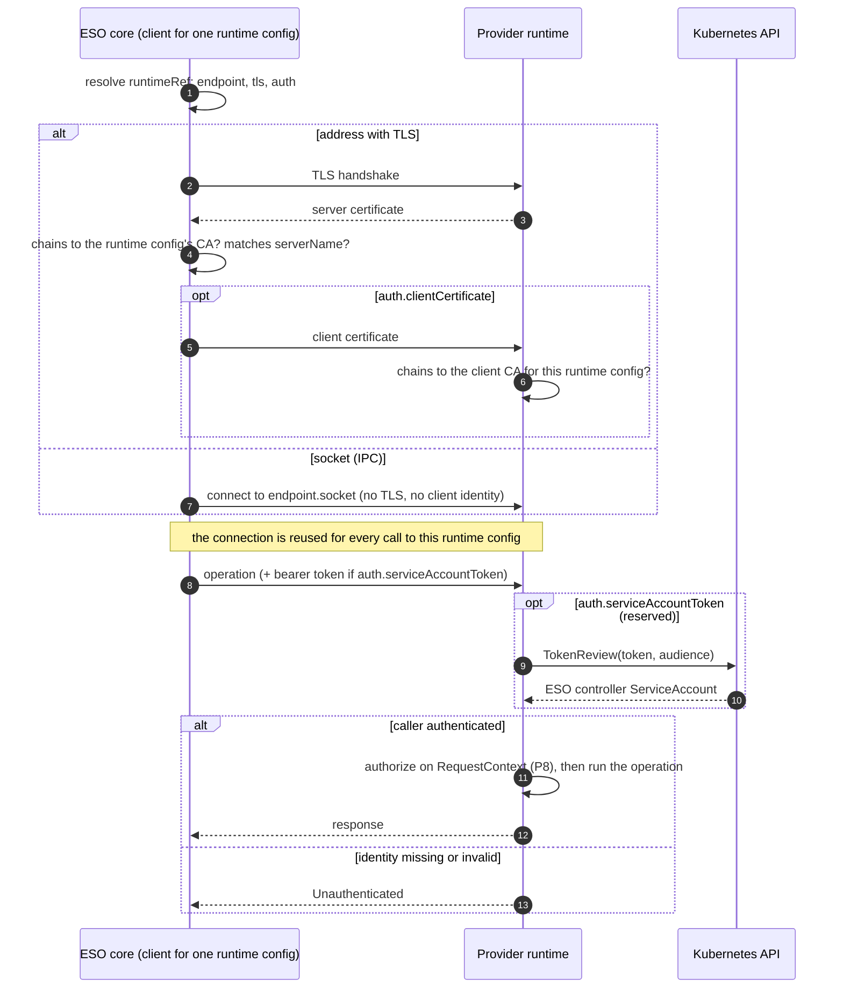
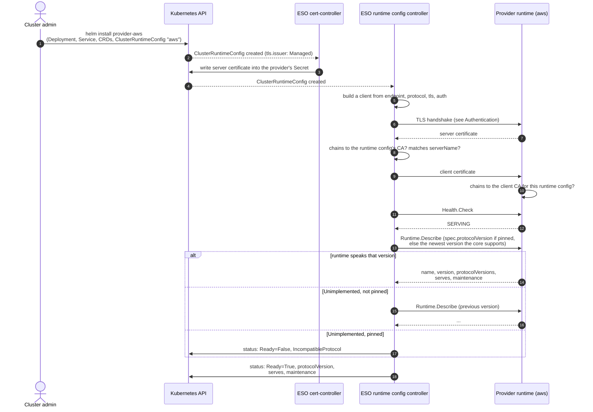
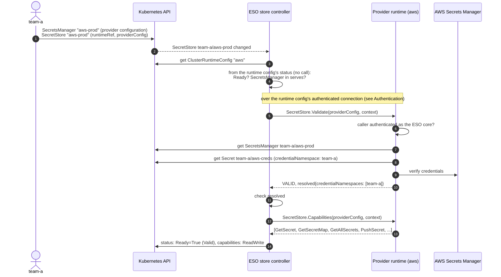
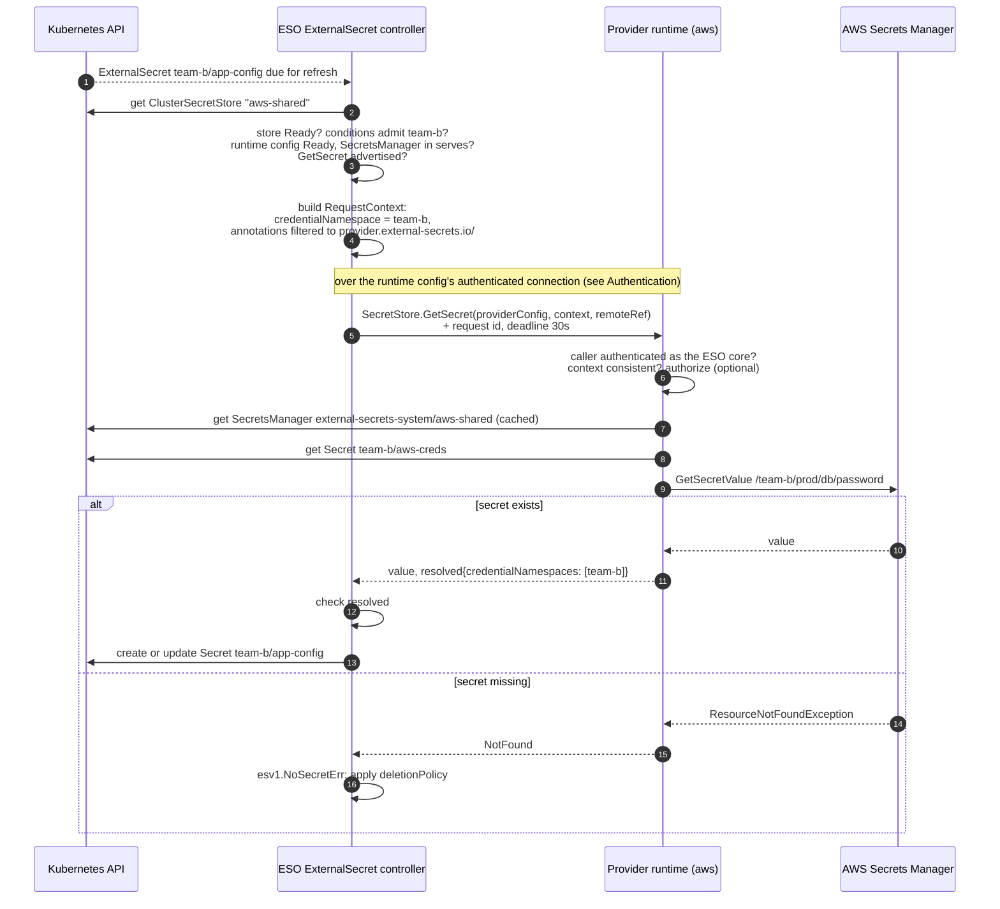
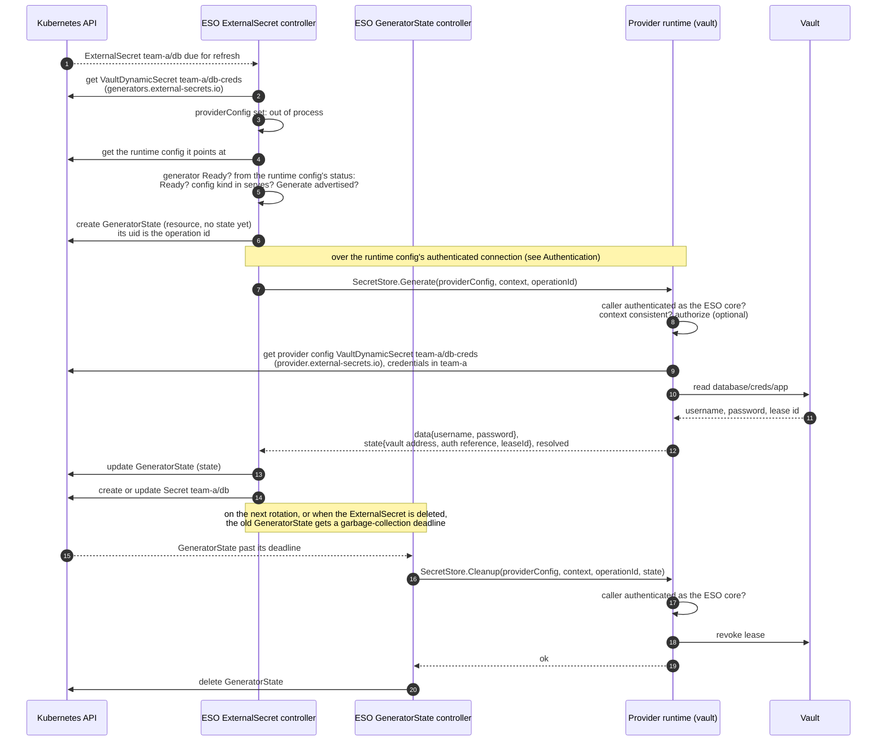
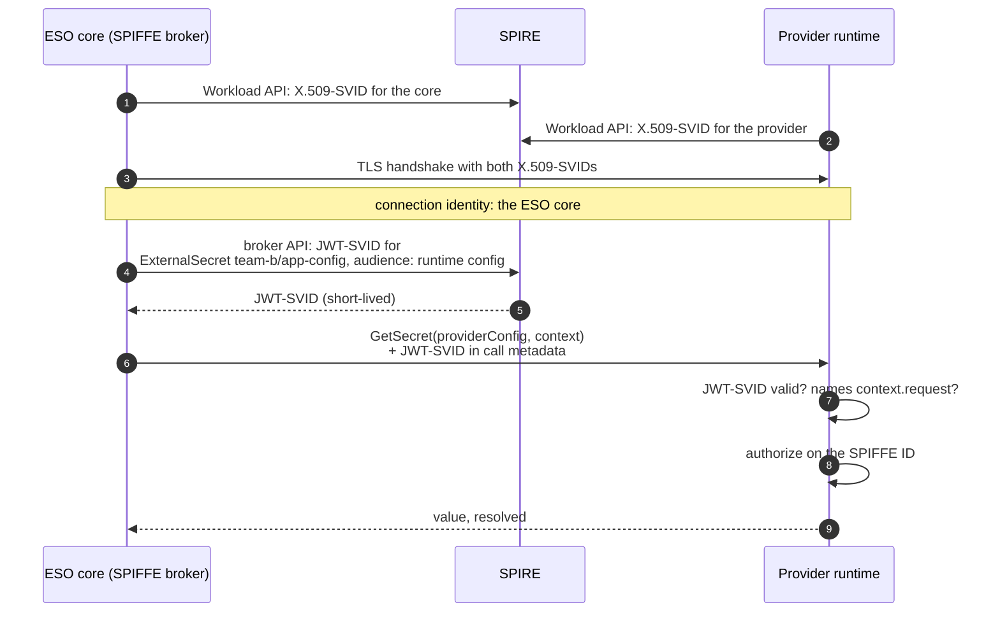

# ESO ⇄ Provider Contract

This document defines what the ESO core and a provider runtime say to each
other: which operations exist, what data each one carries, and what each error
means. It does not define how the bytes travel. That is the job of a
**binding**, and each runtime config picks one with `spec.protocol`:

- [PROTOCOL_GRPC.md](./PROTOCOL_GRPC.md): `protocol: grpc`, protobuf over HTTP/2, the default.
- [PROTOCOL_HTTP.md](./PROTOCOL_HTTP.md): `protocol: http`, JSON over HTTP (reserved).

Both bindings are generated from one protobuf file, so they carry exactly the
same data. A binding never adds operations, fields or error meanings. The
connection itself (address or socket, TLS, client authentication) comes from
the runtime config, as described in [API.md](./API.md) "Transport compositions".

```
  ESO core ──── contract (this document) ────► provider runtime
               encoded by a binding:     grpc | http
               carried by a composition: endpoint · tls · auth
```

## Services and operations

A provider runtime is one process that serves three services. All of them use
the same contract version, so one version negotiation covers all of them.

| Service | Operations | Who calls it |
| --- | --- | --- |
| **Runtime** | `Describe` | runtime config controller |
| **Health** | `Check` | runtime config controller |
| **SecretStore** | `Validate`, `Capabilities` | store controller and generator controller |
| | `GetSecret`, `GetSecretMap`, `GetAllSecrets` | `ExternalSecret` controller |
| | `PushSecret`, `DeleteSecret`, `SecretExists` | `PushSecret` controller |
| | `Generate` | `ExternalSecret` and `PushSecret` controllers, through a generator |
| | `Cleanup` | `GeneratorState` controller |

There is one provider interface, not one for stores and one for generators.
The SecretStore service is the union of v1's `SecretsClient` and `Generator`
interfaces, and a configuration says through `Capabilities` which of its
operations it supports. For the core that means one protocol: the ESO object
decides which operation to call, and the capabilities decide whether it may.

- A **store** (`SecretStore`, `ClusterSecretStore`) leads to the read and
  write operations.
- A **generator** leads to `Generate` and `Cleanup`. Here "a generator" means
  one of the existing generator objects in
  `generators.external-secrets.io/v1alpha1` (`Password`,
  `ECRAuthorizationToken`, `VaultDynamicSecret`, ..., or a `ClusterGenerator`)
  whose spec sets `runtimeRef` and `providerConfig` instead of its inline
  fields ([API.md](./API.md) "Out-of-process generators"). A generator with
  inline fields still runs in process, as it does today, and never reaches
  this contract.

A configuration kind may support reads, writes, generation, or any mix. The
AWS runtime, for example, serves `SecretsManager` and `ParameterStore` for
reads and writes, and `ECRAuthorizationToken` for `Generate`. A Vault
configuration could support both `GetSecret` and `Generate`. A
password-generator runtime advertises only `Generate`.

Every operation is unary: one request, then one response or one error.

### Runtime and Health

- **`Describe`** tells the core what this runtime is:
  - its name and version;
  - the contract versions it speaks;
  - the configuration kinds it serves (`serves`), for stores and generators
    alike. These are GVKs the runtime understands, not necessarily CRDs: a
    `gvkRef` may name a `Secret` or a `ConfigMap`;
  - its maintenance status: `MAINTAINED`, `NOT_MAINTAINED` or `DEPRECATED`, as
    v1's `esv1.MaintenanceStatus`.

  Only the runtime config controller calls it: on every change to the runtime
  config, and every `spec.refreshInterval` otherwise (default: the store
  requeue interval, 5m). It copies the answer into the runtime config status,
  so a provider upgrade that changes what the runtime serves shows up within
  one interval. Every other controller (store,
  generator, `ExternalSecret`, `PushSecret`) reads that status and never calls
  `Describe`: a configuration whose kind is not in `status.serves` is refused
  without a call, with reason `ProviderConfigNotServed`. `Describe` carries no
  capabilities: those belong to one configuration and come from
  `Capabilities`.

  A runtime that reports `NOT_MAINTAINED` or `DEPRECATED` gets the same Warning
  events v1 emits for an unmaintained provider (`StoreUnmaintained`,
  `StoreDeprecated`), on every store and generator that uses it, and the
  runtime config shows the status in `status.maintenance`. An unset status is
  treated as no claim: nothing is emitted.
- **`Check`** answers one question: can this runtime serve calls right now?
  The answer is `SERVING` or `NOT_SERVING`. It is the standard gRPC health
  check, so off-the-shelf libraries implement it.

### Configuration

- **`Validate`** checks one configuration end to end:
  - the configuration exists and is well formed;
  - its credentials resolve;
  - the backend accepts them, as far as that can be checked without reading
    a secret or generating anything.

  The answer is `VALID`, or `UNKNOWN` when there is no caller whose namespace
  the credentials could resolve in. That happens for a `ClusterSecretStore`
  with referent authentication, which v1 also cannot validate, and for a
  `ClusterGenerator`, whose credentials resolve in the caller's namespace. A
  failure is an error code, never a result value: a missing or invalid
  configuration, or a missing referenced Secret or ServiceAccount, is
  `FailedPrecondition`; a credential or permission the backend or the
  Kubernetes API refuses is `PermissionDenied` (see "Errors"). Both leave the
  store or generator `Ready=False` with reason `ProviderValidationFailed` and
  the provider's message. `Validate` may also return warnings, which the core
  turns into events on the object. This is also an extension point for any
  other validation conditions - e.g. authN/authZ denied between ESO and the
  Provider, etc.

  For a configuration that supports `Generate`, the answer also says what it
  produces: the keys `Generate` returns (`outputs`, empty when they depend on
  the backend) and whether its values need `Cleanup` (`stateful`). The
  generator controller writes both into the generator's status.
- **`Capabilities`** lists the operations one configuration supports. It is
  the only source of capabilities: a runtime may serve a read-only kind next
  to a read-write one, and a generate-only kind next to both, and credentials
  can narrow what one configuration may do.

### Reads and writes

- **`GetSecret`** returns the bytes at a remote reference (key, version,
  property). When nothing exists there, it answers `NotFound`. Only a missing
  remote secret is `NotFound`, because the `ExternalSecret`'s `deletionPolicy`
  depends on it.
- **`GetSecretMap`** returns the key/value map at a remote reference.
- **`GetAllSecrets`** returns every secret matching a `find` query (path, name
  regexp, tags), keyed by name.
- **`PushSecret`** writes one entry of a source Secret to a remote key. The
  core renders templates before the call; a provider never sees a template.
- **`DeleteSecret`** removes what `PushSecret` wrote. Deleting something that
  does not exist succeeds, so a retried delete, or a delete after someone
  cleaned up by hand, does not leave the `PushSecret` stuck on its finalizer.
- **`SecretExists`** reports whether a remote key exists. `false` is a normal
  answer, not `NotFound`.

### Generation

- **`Generate`** creates new values: a token, a password, a set of short-lived
  credentials. It returns them together with an opaque **state**, which is
  whatever the provider needs later to revoke them. The core stores the state
  in a `GeneratorState` object, exactly as v1 does for in-process generators.
- **`Cleanup`** receives that state back and revokes what `Generate` created.
  The `GeneratorState` controller calls it when the values are rotated or the
  owner is deleted. Cleaning up something that is already gone succeeds.

A configuration that advertises `Generate` must also serve `Cleanup`; there is
no separate capability for it.

**What may go in `State`.** The core stores `State` verbatim in
`GeneratorState.spec.state`, which is not a Secret: anyone who can read
`GeneratorState` objects in that namespace can read it, it shows in `kubectl
get -o yaml` and in backups, and it is not covered by Secret encryption at rest.
It also crosses the wire twice, on `Generate` and on `Cleanup`, protected only
by the runtime config's transport. Providers therefore treat it as readable
metadata:

- **Allowed:** identifiers that let `Cleanup` find what was created (lease id,
  token id, user name, certificate serial number), expiry times, the backend
  endpoint, and references to credentials (Secret name and key), never their
  values.
- **Never:** the generated values, a private key, a password, a token, or any
  credential, even short-lived. Knowing a certificate's serial number must not
  be the same as holding its key.
- **When `Cleanup` truly needs a secret** (a backend that can only revoke with
  the token it issued), the provider keeps it in its own store, or encrypts it
  with a key only the provider holds, and puts the reference or the ciphertext
  in `State`.

The conformance suite checks that no generated value appears in `State`. A runtime that returns an empty state is never
asked to clean up (a password generator, for example).

### Properties of each operation

| Operation | Service | Takes a `ProviderConfigReference` | Retried by the core on `Unavailable` | Capability string | Mandatory |
| --- | --- | --- | --- | --- | --- |
| `Describe` | Runtime | no | yes | – | yes |
| `Check` | Health | no | yes | – | yes |
| `Validate` | SecretStore | yes | yes | – | if any kind is served |
| `Capabilities` | SecretStore | yes | yes | – | if any kind is served |
| `GetSecret` | SecretStore | yes | yes | `GetSecret` | if advertised |
| `GetSecretMap` | SecretStore | yes | yes | `GetSecretMap` | if advertised |
| `GetAllSecrets` | SecretStore | yes | yes | `GetAllSecrets` | if advertised |
| `PushSecret` | SecretStore | yes | no | `PushSecret` | if advertised |
| `DeleteSecret` | SecretStore | yes | no | `DeleteSecret` | if advertised |
| `SecretExists` | SecretStore | yes | yes | `SecretExists` | if advertised |
| `Generate` | SecretStore | yes | no | `Generate` | if advertised |
| `Cleanup` | SecretStore | yes | yes | (`Generate`) | if `Generate` is advertised |

The core calls an operation only when the configuration's kind is in the
runtime config's `status.serves` and its `Capabilities` advertise the
operation. Both checks happen when the `ExternalSecret` or `PushSecret` is
reconciled, from status the core already has, so a call that cannot succeed is
dropped and never sent. When it refuses, the `ExternalSecret` or `PushSecret` reports
`store does not support <Operation>` and no call is made. The read and write
capability strings project onto the store's existing `status.capabilities`:
any read capability gives `ReadOnly`, any write capability gives `WriteOnly`,
and both give `ReadWrite`; `Generate` does not count. The core ignores
capability strings it does not know, so new ones can be added later.

## Authentication

Before a provider runs any operation, both sides know who they are talking to.
This happens the same way whichever binding carries the call: a binding only
decides how the bytes, and the reserved bearer token, travel. What is used
comes from the runtime config's composition (`endpoint`, `tls`, `auth`,
[API.md](./API.md) "Transport compositions"). How certificates are issued and
rotated is to be detailed on further documents.

Authentication answers two questions, in this order.

**1. Is this the runtime the runtime config names?** The core checks the
server.

- With `tls.enabled`, the server certificate must chain to the CA the runtime
  config names: the runtime config's own managed CA with `issuer: Managed`, or
  `caBundle` / `caRef` with `issuer: External`. It must also match
  `tls.serverName`, which defaults to the host part of `endpoint.address`.
- Over a socket there is no TLS. The core trusts whatever listens on
  `endpoint.socket`, which is why a socket is only accepted on a
  `ClusterRuntimeConfig`.
- `insecureSkipVerify` skips this check. It is a development-only composition.

**2. Is this caller the ESO core?** The provider checks the client, as the
runtime config's `auth` says:

| `auth` | Checked | What the provider verifies |
| --- | --- | --- |
| `clientCertificate` | once per connection, in the TLS handshake | the client certificate chains to the client CA it was given for this runtime config: the runtime config's managed CA, or the operator's |
| `serviceAccountToken` *(reserved)* | on every call, before the operation runs | the bearer token in the call metadata, with a `TokenReview`: authenticated, issued for the runtime config's audience (default: its name), and belonging to the ESO controller's ServiceAccount |
| none, over a socket (IPC) | – | nothing: the container boundary is the identity |
| none, over an address (`HTTP(dev)`, `HTTPS(dev)`) | – | nothing. Only accepted with `--experimental-allow-insecure-provider-transport`, and the runtime config reports `Insecure=True` |



Rules both sides follow:

- **Authenticate before dispatch.** A provider never runs an operation, and
  never reads its configuration, for a caller it has not authenticated. A
  missing or invalid bearer token gets `Unauthenticated`.
- **A rejected handshake is an authentication failure.** When the provider
  rejects the client certificate in the handshake, no code comes back. The core
  classifies that handshake failure (a TLS alert from the server such as
  `bad_certificate`, `certificate_required` or `unknown_ca`) as `Unauthenticated`, so the outcome is the
  same as for a rejected token (see "Errors"). When the core cannot verify the
  server, it does not send the call, and the runtime config is `Ready=False`
  with reason `TLSConfigFailed`.
- **One handshake per connection.** The core keeps one connection per runtime
  config and re-dials it when anything that changes the identity changes, and
  whenever it is older than the runtime config's `spec.maxConnectionAge`
  (default 1h), so rotated certificates take effect. Each binding gives
  the details.
- **Authentication is not authorization.** It tells a provider that the call
  comes from the ESO core, and nothing more. Whether this request may touch this
  secret is decided on `RequestContext` (P8).

| Failure | Runtime config (`Check`, `Describe`) | Store or generator (`Validate`) | `ExternalSecret` / `PushSecret` |
| --- | --- | --- | --- |
| the core cannot verify the server | `Ready=False`, `TLSConfigFailed` | `Ready=False`, `RuntimeNotReady` | `SecretSyncedError` / `Errored` |
| the provider rejects the core (`Unauthenticated`) | `Ready=False`, `AuthenticationFailed` | `Ready=False`, `ProviderAuthenticationFailed` | `SecretSyncedError` / `Errored`, requeue |

## Flows

The diagrams below use the running example of this design: the AWS provider
runs once in `external-secrets-system`, and tenants `team-a` and `team-b` use
it.

### Registering a provider runtime

Installing the provider's chart creates its Deployment, Service, CRDs and a
`ClusterRuntimeConfig`. From then on, the runtime config controller owns the
relationship.



The controller repeats the health check and `Describe` every
`spec.refreshInterval`, and on every change to the runtime config. If `Check`
fails, the runtime config is `Ready=False` with reason `Unreachable`. If no
contract version overlaps, or a pinned version is not served, the reason is
`IncompatibleProtocol`. If the runtime
rejects the core's client certificate, the reason is `AuthenticationFailed`; if
the core cannot verify the runtime's server certificate, it is `TLSConfigFailed`.
The connection built here is the one every later call to this runtime config
reuses.

### A store becoming ready

A tenant points a `SecretStore` at the runtime config and at a provider configuration
in its own namespace.



The core reads the runtime config, never the provider's configuration. Only the provider
reads `SecretsManager` objects and the credentials they reference.

### Reading a secret

An `ExternalSecret` in `team-b` reads through the `ClusterSecretStore`
`aws-shared`, which points at one shared configuration in
`external-secrets-system`. Its credential references carry no namespace, so
they resolve in the caller's namespace (referent authentication).



The `PushSecret` flow has the same shape. The `PushSecret` controller renders
the source Secret and calls `PushSecret` once for each `data` entry. On
deletion, the finalizer calls `DeleteSecret` for each entry it pushed.

### Generating and cleaning up

An `ExternalSecret` in `team-a` uses the generator `VaultDynamicSecret`
`team-a/db-creds` to get short-lived database credentials from Vault. It is
the same kind of object the `ExternalSecret` referenced before the migration,
but its spec now holds only a `runtimeRef` and a `providerConfig`, so the
`ExternalSecret` did not change. Vault returns a lease with the credentials,
and the lease is what `Cleanup` revokes. The generator controller has already
called `Validate` for `db-creds`, so the generator is `Ready=True` with
`outputs: [username, password]` and `stateful: true`.



`Cleanup` is sent the `providerConfig` recorded in the `GeneratorState` at
`Generate` time, not the generator's current one. That reference only says
where the configuration lives. In v1 the recorded generator manifest *is* the
configuration, so the `GeneratorState` snapshot is enough to clean up. Here the
configuration is a provider-owned object that the core never reads, so the
snapshot must come from the provider: `State` carries the configuration fields
`Cleanup` needs (for Vault: the server address, the auth reference and the
lease id), with credential *references* but never credential values
(obligation 7). Values are then revoked by the configuration that created them,
even after that configuration is edited or deleted, as long as the referenced
credentials still exist. That is v1's guarantee. If `Cleanup` fails, the `GeneratorState` stays and the controller
retries, as it does in v1.

**Lost responses.** For every `Generate`, the core writes the
`GeneratorState` *before* the call, and sends the object's
`metadata.uid` as `operationId`. The id is durable: it survives a lost
response, a timeout and a core restart.

- A `Generate` that fails, for example with `Unavailable` or
  `DeadlineExceeded`, leaves the `GeneratorState` without state. The next
  reconcile finds it and calls `Generate` again with the same `operationId`.
  The provider must not leave a second live generation behind for that id
  (obligation 7).
- When a `GeneratorState` that still has no state is garbage-collected (for
  example, the `ExternalSecret` was deleted), the core calls `Cleanup` with its
  `operationId` and an empty `state`. The provider revokes whatever it created
  under that id, or answers success if it created nothing.
- A `Generate` that outlives its call deadline must not create anything
  afterwards. The provider abandons it when the deadline passes, and once
  `Cleanup` has succeeded for an `operationId`, a later `Generate` with that id
  creates nothing and fails with `FailedPrecondition`. Together with the
  `ExternalSecret` reconcile being serialized per object and the garbage
  collection grace period (`--generator-gc-grace-period`), this keeps a late
  `Generate` from creating a lease after its own cleanup.
- When `Generate` returns an empty `State`, there is nothing to revoke, and the
  core deletes the `GeneratorState` it wrote. The core does not skip the write
  for a generator whose `status.stateful` is false, because the configuration
  can change between two validations; `stateful` is informational.

## Data model

The protobuf file in [PROTOCOL_GRPC.md](./PROTOCOL_GRPC.md) is the normative
schema. Below are the same types as the Go structs that `protoc-gen-go`
generates from it. Struct tags and protobuf bookkeeping fields are left out,
and enum constants are shortened. Field names keep the generated spelling
(`ApiVersion`, `Uid`), because that is what code on both sides uses.

On the wire every field is optional. The comments say which fields the sender
must fill; a receiver may reject a request that leaves one empty with
`InvalidArgument`.

### Addressing

```go
// ProviderConfigReference names one provider configuration. It mirrors the
// spec.providerConfig union of a SecretStore, a ClusterSecretStore or an
// out-of-process generator: exactly one member is set. The core forwards the member
// it was given, never the configuration itself (P1). Later members (KeyRef,
// UUIDRef, LabelSelector) are additive. A provider that receives no member it
// understands answers InvalidArgument.
type ProviderConfigReference struct {
	GVKRef *GVKReference // the only member in v1alpha1
}

// GVKReference names the configuration as an object: usually a provider-owned
// custom resource, but any kind the provider understands is valid.
type GVKReference struct {
	ApiVersion string // required. Group/version of the configuration kind.
	Kind       string // required. e.g. SecretsManager. Listed in the runtime config's
	                  // status.serves.
	Name       string // required.
	Namespace  string // required. Where the configuration lives. The core always
	                  // fills it. It is a tenant boundary: configuration in team-a
	                  // is configuration that team-a controls.
}

// ObjectReference identifies a Kubernetes object, so that a provider can log,
// cache and authorize on it without reading it.
type ObjectReference struct {
	ApiVersion string // required.
	Kind       string // required.
	Namespace  string // empty for cluster-scoped objects.
	Name       string // required.
	Uid        string // required.
	Generation int64
}
```

### Request context

Every request that takes a `ProviderConfigReference` also carries a
`RequestContext`. It says who is asking, through which object, and where
credential references resolve.

```go
type RequestContext struct {
	// Request is the object whose reconcile caused the call: an ExternalSecret
	// or a PushSecret. A ClusterExternalSecret appears as the ExternalSecret it
	// created. Nil for Validate and Capabilities, which have no caller. For
	// Cleanup, it is the owner recorded in the GeneratorState, which may no longer
	// exist. Only that reference is recorded, so on Cleanup RequestLabels and
	// RequestAnnotations are empty: a provider must not authorize Cleanup on them.
	Request *ObjectReference

	// Source is the object the request resolved through: a SecretStore, a
	// ClusterSecretStore, or a generator (a generator kind such as
	// generators.external-secrets.io/v1alpha1 VaultDynamicSecret, or a
	// ClusterGenerator). For an
	// ExternalSecret data[].sourceRef entry, it is that entry's store. Always set.
	Source *ObjectReference

	// CallerNamespace is Request.Namespace, stated separately because every
	// namespace rule reads it. Empty if and only if Request is nil.
	CallerNamespace string

	// ControllerClass is the store's spec.controller. Empty for generators.
	ControllerClass string

	// RequestLabels holds all labels of Request.
	RequestLabels map[string]string

	// RequestAnnotations holds only the annotations of Request whose key starts
	// with "provider.external-secrets.io/", with keys unchanged (P8).
	RequestAnnotations map[string]string

	// Attributes is reserved for future authorization inputs. Empty in
	// milestone 1.
	Attributes map[string]string

	// CredentialNamespace is where credential references without a namespace
	// resolve (P9). See the table below.
	CredentialNamespace string

	// AllowExplicitCredentialNamespace says whether a credential reference's own
	// namespace is honoured. When false, a reference may only name
	// CredentialNamespace.
	AllowExplicitCredentialNamespace bool
}
```

The core computes the namespace fields from the source kind. The provider
rejects a context that does not match this table with `InvalidArgument`:

| `Source.Kind` | `ProviderConfigReference.Namespace` | `CredentialNamespace` | `AllowExplicitCredentialNamespace` |
| --- | --- | --- | --- |
| `SecretStore` | the store's namespace | the store's namespace | `false` |
| `ClusterSecretStore` | the store's `providerConfig.gvkRef.namespace` | `CallerNamespace` (empty when validating without a caller) | `true` |
| a namespaced generator kind (`Password`, `VaultDynamicSecret`, ...) | the generator's namespace (equal to `CallerNamespace` when there is a caller) | the generator's namespace | `false` |
| `ClusterGenerator` | the generator's `providerConfig.gvkRef.namespace` | `CallerNamespace` (empty when validating without a caller) | `false` |

`Validate` has no caller, so `CallerNamespace` is empty and no column is
compared with it. A namespaced generator follows the `SecretStore` row. A
`ClusterGenerator` keeps v1's generator behaviour: credentials resolve in the
caller's namespace, as on a `ClusterSecretStore`, but an explicit namespace
is never honoured (P9). The provider tells a store from a generator by
`Source.ApiVersion`: generators are in `generators.external-secrets.io`.

### Resolved

Every response to an operation that takes a `ProviderConfigReference` carries the
provider's report of what it used. The core checks it (see "Contract
enforcement").

```go
type Resolved struct {
	// CredentialNamespaces lists every namespace a credential reference was
	// resolved in for this call. Empty when none was.
	CredentialNamespaces []string

	// ProviderUid is a stable identity of the configuration used: the object's
	// uid when it is a Kubernetes object, otherwise any id that is stable for the
	// configuration's lifetime. Logged and put on events.
	ProviderUid string

	// ProviderGeneration increases whenever that configuration changes:
	// metadata.generation, or an equivalent.
	ProviderGeneration int64
}
```

### Runtime and Health

```go
type DescribeRequest struct{}

type DescribeResponse struct {
	ProviderName     string        // e.g. "aws"
	ProviderVersion  string        // e.g. "v2.16.0"
	ProtocolVersions []string      // contract versions served, e.g. ["v1alpha1"] (P5)
	Serves           []*ServedKind     // configuration GVKs a store or generator may point at
	Maintenance      MaintenanceStatus // MAINTAINED, NOT_MAINTAINED or DEPRECATED; unset is no claim
}

type MaintenanceStatus int32

const (
	MaintenanceStatusUnspecified   MaintenanceStatus = 0
	MaintenanceStatusMaintained    MaintenanceStatus = 1
	MaintenanceStatusNotMaintained MaintenanceStatus = 2
	MaintenanceStatusDeprecated    MaintenanceStatus = 3
)

type ServedKind struct {
	ApiVersion string
	Kind       string
}

// Health is grpc.health.v1, used as is.
type HealthCheckRequest struct {
	Service string // always "": the core asks about the runtime as a whole
}

type HealthCheckResponse struct {
	Status ServingStatus // SERVING or NOT_SERVING
}
```

### SecretStore

```go
type ValidateRequest struct {
	ProviderConfig *ProviderConfigReference // required
	Context     *RequestContext    // required; Request is nil
}

type ValidateResponse struct {
	Result   ValidationResult // VALID or UNKNOWN
	Warnings []string         // turned into events on the store or generator

	// Set only for a configuration that advertises Generate.
	Outputs  []string // the keys Generate returns; empty when they depend on the backend
	Stateful bool     // true when Generate returns state that Cleanup must revoke

	Resolved *Resolved
}

type ValidationResult int32

const (
	ValidationResultUnspecified ValidationResult = 0 // a provider bug; the core treats it as Internal
	ValidationResultValid       ValidationResult = 1
	ValidationResultUnknown     ValidationResult = 2 // no caller to resolve credentials for
)

type CapabilitiesRequest struct {
	ProviderConfig *ProviderConfigReference // required
	Context     *RequestContext    // required; Request is nil
}

type CapabilitiesResponse struct {
	Capabilities []string // e.g. ["GetSecret", "GetSecretMap"]
	Resolved     *Resolved
}

// RemoteRef addresses one secret in the backend. It mirrors
// ExternalSecret.spec.data[].remoteRef.
type RemoteRef struct {
	Key              string // required
	Version          string
	Property         string
	DecodingStrategy string // esv1.ExternalSecretDecodingStrategy
	MetadataPolicy   string // esv1.ExternalSecretMetadataPolicy
}

type GetSecretRequest struct {
	ProviderConfig *ProviderConfigReference // required
	Context     *RequestContext    // required
	RemoteRef   *RemoteRef         // required
}

type GetSecretResponse struct {
	Value    []byte
	Resolved *Resolved
}

type GetSecretMapRequest struct {
	ProviderConfig *ProviderConfigReference // required
	Context     *RequestContext    // required
	RemoteRef   *RemoteRef         // required
}

type GetSecretMapResponse struct {
	Data     map[string][]byte
	Resolved *Resolved
}

// Find mirrors ExternalSecret.spec.dataFrom[].find.
type Find struct {
	Path               *string // nil and "" differ, as in v1's ExternalSecretFind.Path
	Name               *FindName
	Tags               map[string]string
	ConversionStrategy string
	DecodingStrategy   string
}

type FindName struct {
	Regexp string
}

type GetAllSecretsRequest struct {
	ProviderConfig *ProviderConfigReference // required
	Context     *RequestContext    // required
	Find        *Find              // required
}

type GetAllSecretsResponse struct {
	Data     map[string][]byte // keyed by remote name; the core applies the conversion strategy
	Resolved *Resolved
}

// PushSecretData mirrors PushSecret.spec.data[].match plus its metadata.
type PushSecretData struct {
	SecretKey string // key in the source Secret; empty pushes the whole Secret
	RemoteKey string // required
	Property  string
	Metadata  []byte // PushSecret.spec.data[].metadata, as JSON
}

type PushSecretRequest struct {
	ProviderConfig       *ProviderConfigReference // required
	Context           *RequestContext    // required
	Data              *PushSecretData    // required
	SecretData        map[string][]byte  // the rendered source Secret's data
	SecretType        string
	SecretLabels      map[string]string  // of the source Secret, verbatim
	SecretAnnotations map[string]string  // of the source Secret, verbatim (not filtered:
	                                     // this is data to push, not request metadata)
}

type PushSecretResponse struct {
	Resolved *Resolved
}

type PushRemoteRef struct {
	RemoteKey string // required
	Property  string
}

type DeleteSecretRequest struct {
	ProviderConfig *ProviderConfigReference // required
	Context     *RequestContext    // required
	RemoteRef   *PushRemoteRef     // required
}

type DeleteSecretResponse struct {
	Resolved *Resolved
}

type SecretExistsRequest struct {
	ProviderConfig *ProviderConfigReference // required
	Context     *RequestContext    // required
	RemoteRef   *PushRemoteRef     // required
}

type SecretExistsResponse struct {
	Exists   bool
	Resolved *Resolved
}
```

### Generation

Also operations of the SecretStore service.

```go
type GenerateRequest struct {
	ProviderConfig *ProviderConfigReference // required
	Context     *RequestContext    // required; Source is the generator object

	// OperationId identifies this generation across retries: the uid of the
	// GeneratorState the core wrote before the call. Always set. A repeat with
	// the same id must not leave a second live generation behind.
	OperationId string
}

type GenerateResponse struct {
	Data map[string][]byte // the generated keys and values

	// State is opaque to the core. The core stores it in the GeneratorState and
	// sends it back unchanged on Cleanup. Empty means there is nothing to clean
	// up; the core then deletes the GeneratorState it wrote for the call, and
	// Cleanup is never called for it. It is stored in a Kubernetes object, so
	// keep it small: an id, an expiry and the configuration fields Cleanup
	// needs (obligation 7), never the generated secret or a credential.
	State []byte

	Resolved *Resolved
}

type CleanupRequest struct {
	ProviderConfig *ProviderConfigReference // required; as recorded at Generate time
	Context     *RequestContext    // required; rebuilt from the GeneratorState, without request labels or annotations
	OperationId string             // as sent to Generate
	State       []byte             // exactly what Generate returned; empty when its response was never recorded
}

type CleanupResponse struct {
	Resolved *Resolved
}
```

### Error detail

```go
// ProviderError is an optional detail attached to an error (P3). No core
// behaviour depends on it; it adds context to messages and logs.
type ProviderError struct {
	Code    string            // provider-defined, e.g. "AccessDeniedException",
	                          // "ExplicitNamespaceNotAllowed", "Unauthorized"
	Message string
	Details map[string]string
}
```

### Example: one call, fully populated

The `GetSecret` from "Reading a secret", with every field filled. The values
are shown as YAML so that no binding is implied. The two binding documents show
the same call on the wire.

```yaml
operation: SecretStore.GetSecret      # contract v1alpha1
metadata:
  requestId: 01JD3X8Q4M7R2N5V6W9Y0Z1A2B
  deadline: 30s
request:
  providerConfig:
    gvkRef:
      apiVersion: provider.external-secrets.io/v1alpha1
      kind: SecretsManager
      namespace: external-secrets-system
      name: aws-shared
  context:
    request:
      apiVersion: external-secrets.io/v1
      kind: ExternalSecret
      namespace: team-b
      name: app-config
      uid: 6f1c2d3e-0000-4000-8000-00000000000b
      generation: 4
    source:
      apiVersion: external-secrets.io/v1
      kind: ClusterSecretStore
      name: aws-shared
      uid: 9a8b7c6d-0000-4000-8000-0000000000aa
      generation: 2
    callerNamespace: team-b
    requestLabels:
      app: billing
      team: payments
    requestAnnotations:                         # kubectl.kubernetes.io/last-applied-configuration
      provider.external-secrets.io/purpose: db  # and the rest were filtered out by the core
    credentialNamespace: team-b                 # referent: the caller's namespace
    allowExplicitCredentialNamespace: true      # ClusterSecretStore
  remoteRef:
    key: /team-b/prod/db/password
response:
  value: <bytes>
  resolved:
    credentialNamespaces: [team-b]              # the core checks nothing more for a cluster store
    providerUid: 3c4d5e6f-0000-4000-8000-0000000000cc
    providerGeneration: 7
```

Through a namespaced `SecretStore` in `team-a`, the same call would carry
`providerConfig.gvkRef.namespace: team-a`, `credentialNamespace: team-a` and
`allowExplicitCredentialNamespace: false`. A `resolved.credentialNamespaces`
containing anything other than `team-a` would then be a contract violation.

## Call metadata

Besides the request message, the core sends exactly these entries with every
call (P11). Each binding says how it carries them. Providers must ignore
anything else.

| Entry | When | Meaning |
| --- | --- | --- |
| request id | always | Unique per call. The core logs it together with `credentialNamespace`. Providers should log it on every line about the call. |
| deadline | always | From the runtime config's `spec.timeout` (default 30s). A provider should stop working once it passes, because the core has already given up. |
| bearer token | only with `auth.serviceAccountToken` *(reserved)* | A projected ServiceAccount token of the ESO controller. The provider validates it with `TokenReview`. It is never logged. |

Credentials never travel inside a request or response message.

Messages are limited to 16 MiB in each direction, in every binding (P6).

## Errors

A failed call returns a code, a message, and optionally a `ProviderError`
detail. The core decides what to do from the code alone. These are the codes
gRPC and Connect share; each binding encodes them natively. Any other code is
treated as `Unknown`.

| Code | The provider returns it when | Outcome on `Validate` / `Capabilities` | Outcome on a read, write or generator call |
| --- | --- | --- | --- |
| `NotFound` | the remote secret does not exist, and for nothing else. A missing configuration is `FailedPrecondition` | store `Ready=False`, `ProviderValidationFailed` | `esv1.NoSecretErr`, so `deletionPolicy` applies |
| `InvalidArgument` | the request is malformed (empty key, unknown decoding strategy) or its `RequestContext` is inconsistent | store `Ready=False`, `ProviderValidationFailed` | ES `SecretSyncedError` / PS `Errored`, no immediate retry |
| `FailedPrecondition` | the configuration is missing or invalid, a referenced Secret or ServiceAccount is missing, or an explicit credential namespace is not allowed (`ExplicitNamespaceNotAllowed`) | store `Ready=False`, `ProviderValidationFailed` | ES `SecretSyncedError` / PS `Errored` |
| `PermissionDenied` | the backend refused the credentials; the provider's own identity was refused while it resolved the configuration or its credentials (for example `Forbidden` from the Kubernetes API on a Secret, a ServiceAccount token or its configuration kind); or the provider's own authorization refused the request (P8; detail `Unauthorized` by convention) | store `Ready=False`, `ProviderValidationFailed` | ES `SecretSyncedError` / PS `Errored`, with the provider's message |
| `Unauthenticated` | the provider did not accept the core's identity (client certificate or bearer token invalid or absent) | store `Ready=False`, `ProviderAuthenticationFailed`. On `Check` or `Describe`: runtime config `Ready=False`, `AuthenticationFailed` | ES `SecretSyncedError` / PS `Errored`, requeue |
| `Unimplemented` | the operation is not supported for this configuration | store `Ready=False`, `ProviderValidationFailed` | ES `SecretSyncedError` / PS `Errored`. Should not happen, because the core checks capabilities first |
| `AlreadyExists` | `PushSecret` found remote state it will not overwrite | – | PS `Errored`, no immediate retry |
| `ResourceExhausted` | the backend rate-limited the call | store `Ready=False`, `ProviderUnreachable`, requeue with backoff | requeue with backoff |
| `Unavailable`, `DeadlineExceeded` | the backend or the runtime is temporarily unreachable. The core's own client also produces these on connection failure or timeout | store `Ready=False`, `ProviderUnreachable` | retried if the operation allows it (P7), then ES `SecretSyncedError` / PS `Errored`, requeue |
| `Internal`, `Unknown` | anything else | store `Ready=False`, `ProviderValidationFailed` | ES `SecretSyncedError` / PS `Errored`, requeue |

For generator calls:

- `Validate` for a generator follows the `Validate` column: read "store" as
  "generator", with the same reasons.
- A failed `Generate` fails the `ExternalSecret` or `PushSecret` that asked for
  it, as an in-process generator error does today. `NotFound` has no special
  meaning there. The `GeneratorState` written for the call stays without
  state, and the next reconcile retries with the same `operationId`.
- A failed `Cleanup` leaves the `GeneratorState` in place, and the controller
  retries it as in v1.

All outcomes use reasons that already exist (store reasons in API.md, and
today's `ExternalSecret` and `PushSecret` reasons). `ExternalSecret` and
`PushSecret` do not change. `esv1.NotModifiedErr` (webhook provider) has no
wire equivalent: a provider with nothing to do answers success.

## What the core sends, what the provider fetches

The boundary is fixed by the contract, so that a provider author knows what to
expect on the wire and what to look up:

| | Sent by the core on every call | Fetched by the provider, if it needs it |
| --- | --- | --- |
| Which configuration | `ProviderConfigReference` (a reference, never the body) | the configuration object it names, from wherever the provider keeps it |
| Who is asking | `RequestContext`: the requesting object, the store or generator it came through, the caller namespace, the credential namespace and whether an explicit one is allowed | nothing: the provider never reads `external-secrets.io` objects |
| Backend credentials | nothing | whatever the configuration points at: a `Secret`, a ServiceAccount token, a workload identity, a database entry |
| Operation input | the remote reference; for `PushSecret`, the rendered bytes and the push metadata | nothing: the provider never reads or writes the target or source Kubernetes `Secret` of a sync |
| Per-call metadata | request id, deadline and, when reserved auth is used, a bearer token (P11); labels and the `provider.external-secrets.io/`-prefixed annotations of the requesting object (P8) | nothing |

Two consequences, both deliberate:

- **The core never reads provider configuration and never resolves
  credentials for a provider.** It cannot: it does not know the
  configuration's schema (README D3), and the configuration may not live in
  Kubernetes at all. A provider that keeps its configuration and credentials
  outside the cluster needs no Kubernetes access whatsoever.
- **What the provider may read is the provider's least-privilege problem, and
  the provider chart sizes it.** The recommended shape is the narrowest one
  that works: read access to its own configuration kinds, and `secrets get` or
  `serviceaccounts/token create` only in the namespaces it serves, or only on
  the named objects its configurations reference. A cluster-wide grant is an
  explicit opt-in (see "Contract enforcement"). This is already narrower than
  v1, where the one ESO controller holds both permissions cluster-wide for
  every provider.

Per-call data a user wants a provider to see travels as
`provider.external-secrets.io/`-prefixed annotations on the requesting
object. `RequestContext` is a message, so new fields are additive within a
contract version (P5).

## Obligations

### Provider

1. Resolve `providerConfig` to the configuration it names, wherever you keep it
   (P1). Fail with `FailedPrecondition` if it does not exist or does not pass
   your own validation. Treat its namespace as a tenant boundary. `Cleanup` is
   the exception: it works from `State` and must not require the configuration
   to still exist (obligation 7).
2. Resolve credential references without a namespace in
   `context.credentialNamespace`. Honour a reference's own namespace only when
   `context.allowExplicitCredentialNamespace` is true, or when it equals
   `context.credentialNamespace` (P9). Never derive a namespace from anything
   else. For a generator, ignoring a differing explicit namespace is allowed
   too, as long as nothing is read outside `context.credentialNamespace`.
3. Reject a `RequestContext` that does not match the table in "Request
   context" with `InvalidArgument`.
4. Cache backend clients per (`providerUid`, `providerGeneration`,
   `credentialNamespace`, `allowExplicitCredentialNamespace`). The last member
   matters: a `SecretStore` and a `ClusterSecretStore` can point at the same
   configuration with the same credential namespace, but only the cluster
   store may have built its client from credentials in another namespace.
   Check the credential-namespace rule on a cache hit as well. Invalidate on change, and bound their lifetime so that a rotated
   credential Secret or ServiceAccount token does not outlive its revocation.
5. Return `NotFound` for a missing remote secret, and for nothing else.
6. Advertise capabilities honestly and answer `Unimplemented` for the rest.
   Serve `Describe` and `Check` on every contract version you serve. Serve
   `Cleanup` for every configuration that advertises `Generate`.
7. Make `Cleanup` idempotent, and make `State` a snapshot of everything it
   needs: the backend identifiers and the configuration fields, so that
   `Cleanup` still works after the configuration is edited or deleted.
   Credentials are the exception: `State` holds their references, never their
   values, and `Cleanup` resolves them again in `credentialNamespace`. Make `Generate` idempotent on
   `operationId`: a repeat must not leave two live generations, and `Cleanup`
   with that id and an empty `State` must revoke what was created under it.
   Stop a `Generate` when its call deadline passes, and create nothing for a
   `Generate` whose `operationId` has already been cleaned up. The guarantee is
   only as strong as the backend. Tag what you create with the id where the
   backend allows it, so that a retry or `Cleanup` can find it. A mapping kept
   on the provider side cannot close the gap between creating a value and
   recording it, so where the backend cannot tag, give what you create a
   bounded lifetime (a lease TTL, an expiring token) so that an orphan expires,
   and say so in your documentation.
8. Authenticate the core as the runtime config's `auth` says: verify the client
   certificate, validate the bearer token (reserved), or rely on the container
   boundary over IPC. Hot-reload server certificates.
9. Authorize if you want to, on `RequestContext` (P8). If you do not, allow
   everything the authenticated core sends. Keep any rules in your own objects
   or configuration.
10. Fill `Resolved` on every response to an operation that takes a
    `ProviderConfigReference`.
11. Never write to any `external-secrets.io` or `generators.external-secrets.io`
    object. You have no RBAC for them, and the core is their only writer.
12. Ignore metadata entries and message fields you do not know.

### Core

1. Send only coordinates taken from a store or generator that passed CEL, with
   a kind listed in the runtime config's `status.serves`.
2. Compute `credentialNamespace` and `allowExplicitCredentialNamespace` for
   each call, and send a `RequestContext` that matches the table.
3. Send only `provider.external-secrets.io/` annotations, and exactly the call
   metadata above.
4. Call only operations the configuration advertises, on the negotiated
   version, within the runtime config deadline. Retry only operations marked as retried.
5. Verify `Resolved` (see "Contract enforcement").
6. Never send credentials in a message.
7. Store generator `State` unchanged and send it back unchanged.
8. Ignore response fields it does not know.

## Contract enforcement

The provider applies the namespace rules, and the core cannot see what the
provider reads. What happens when a provider does not follow them, by bug or
by design, is answered in layers:

1. **RBAC is the backstop, and the operator sizes it.** A provider can only
   read what its ServiceAccount may read. For the migration of currently in-tree
   providers, we can tackle that by making the default the provider's chart
   grants `secrets get` and `serviceaccounts/token create` through a `Role` in
   each namespace it serves (the chart lists them), plus read access to its own
   configuration kinds there. A provider that resolves credentials in a
   namespace it does not serve gets `Forbidden` from the API server, and
   answers `PermissionDenied`.
   The cross-namespace `ClusterRole` needed for referent `ClusterSecretStore`s
   and `ClusterGenerator`s is an explicit opt-in. Granting it is the point at
   which an operator decides to trust that provider with every tenant's
   credentials. A provider that should not be trusted that far does not get it,
   and tenants run it through a namespaced `RuntimeConfig` instead.
   Configuration kept outside Kubernetes (P1) still resolves its credentials
   through this RBAC, or through backend credentials the operator chose to give
   the provider.
2. **The SDK makes conformance the easy path.** Providers built on the SDK wrap
   v1 code. The SDK derives the synthetic store kind and the namespace argument
   from `RequestContext`, and the v1 helper `resolvers.SecretKeyRef` applies
   the rule. Only a provider written from scratch can get it wrong. This is the
   main machanism our current in-tree providers handle this - by leveraging
   common SDKs.
3. **The conformance suite tests the rule, including negative cases.** It
   drives the provider through each binding it claims, against a recording fake
   Kubernetes API, and checks that:
   - references without a namespace resolve in `credentialNamespace`;
   - an explicit namespace is refused through a `SecretStore`, refused or
     ignored through a generator (never read), and honoured through a
     `ClusterSecretStore`;
   - an empty `credentialNamespace` makes `Validate` answer `UNKNOWN`;
   - an inconsistent `RequestContext` is refused;
   - nothing under `external-secrets.io` or `generators.external-secrets.io` is
     ever read.

   Under the governance proposal (PR #7124), a provider is listed as supported/
   maintained only while it passes.
4. **The core checks the self-report.**
   - When `allowExplicitCredentialNamespace` is false, every namespace in
     `Resolved.credentialNamespaces` must equal `credentialNamespace`. When it
     is true, any value is accepted.
   - A mismatch, or a missing `Resolved`, marks the **runtime config** `Ready=False`
     with reason `ContractViolation`, emits a warning event on the object
     that made the call, and stops calls to that runtime.
   - Only the runtime config controller lifts that gate. It reconciles a
     healthy runtime config slowly (once a day by default). After a violation it
     requeues with exponential backoff instead, capped at that interval, and
     each requeue reopens the gate for one call. A correct `Resolved` clears
     `ContractViolation` and resets the backoff; another violation closes the
     gate again and doubles the delay. A healthy `Check` or `Describe` never
     lifts it on its own, because neither returns a `Resolved`. The gate backs
     off rather than latching until an operator steps in, because a violation
     can be transient: a response corrupted or cut short on the network looks
     the same as a missing `Resolved`.
   - `providerUid` and `providerGeneration` are logged and put on events. The
     core does not check them, because it never reads the configuration.

   This catches a buggy provider on its first call, and applies floodgating
   techniques so this provider isn't used until the issue is fixed.
   A malicious provider can lie, which is why layers 1 and 5 exist.
5. **Audit.** Each provider runs under its own ServiceAccount, so the
   Kubernetes audit log shows its reads under that identity. The core logs
   `credentialNamespace` with the request id of every call. A provider that
   reads namespaces its requests never named can be detected afterwards.

The core deliberately does not resolve credentials itself and send them by
value. That would settle the question for Go providers, but every backend
credential would pass through the core process, and the core would need RBAC on
every provider CRD (P1).

## Extending the contract

The contract will grow. This section says how, for each kind of change, so
that an extension never needs a renegotiation of everything else. Every
extension answers four questions: where the change lives, whether it needs a
new contract version, how each side learns that the other supports it, and
what happens when one side is older.

| Change | Lives in | New contract version? | How support is discovered | Older peer |
| --- | --- | --- | --- | --- |
| New authentication mechanism | `RuntimeConfig.spec.auth` (or `tls`), plus one call-metadata entry if it travels per call | no | not discovered: the operator configures both sides | older provider: `Unauthenticated`, runtime config `AuthenticationFailed`. Older core: reserved field, `ProtocolNotSupported` |
| New binding or transport | `RuntimeConfig.spec.protocol` (or `endpoint`), plus a `PROTOCOL_<NAME>.md` | no | not discovered: the operator configures both sides | older core: `ProtocolNotSupported`. Older provider: `Unreachable` or `IncompatibleProtocol` |
| New field or operation on an existing service | `provider.proto`, same package | no, if additive | a capability string, when the core must know the provider honours it | older provider: ignores the field, or never gets the call because the capability is missing |
| Breaking change to an existing service | `provider.proto`, new package | yes | version negotiation, or the pin | the previous version keeps being served side by side |
| A completely new feature | new operations on the SecretStore service in `provider.proto` | no | new capability strings | never advertised, so never called |

### Authentication is extended

Examples: implementing the reserved `auth.serviceAccountToken`; a cloud
workload identity token; replacing mutual TLS with SPIFFE through a SPIFFE
broker (worked example below).

- **API.** A new member under `RuntimeConfig.spec.auth` for the client side, or
  a new server-verification source under `spec.tls`. `auth` takes zero or more
  mechanisms, so a new one combines with the existing ones.
- **Contract.** No message changes. A mechanism that travels per call (a
  token) adds one entry to the closed set in "Call metadata", and each binding
  says how it carries it. Providers already ignore metadata they do not know
  (P11), so the entry is safe to add.
- **Discovery.** None on the wire, on purpose. Authentication happens before
  `Describe`, so `Describe` cannot negotiate it. The operator sets the
  mechanism on the runtime config and on the provider's chart.
- **Rollout.** The field is reserved first: the core accepts it and reports
  `Ready=False / ProtocolNotSupported` until it implements it, as
  `serviceAccountToken` does today. A provider that does not support the
  mechanism rejects the call with `Unauthenticated`, and the runtime config
  reports `AuthenticationFailed`.

#### Worked example: SPIFFE broker instead of mutual TLS

Today the provider authenticates one caller, the ESO core, and learns from
`RequestContext` which `ExternalSecret` the call is for. It has to take the
core's word for that. With SPIFFE, the identity of the `ExternalSecret` itself
can travel with each call, issued by SPIRE rather than by ESO:

- **The connection.** The core and the provider authenticate each other with
  X.509-SVIDs from the SPIFFE Workload API instead of the managed or external
  certificates. SPIRE issues and rotates them, so the `Managed` issuer and the
  client-certificate Secret are not needed for that runtime config.
- **The call.** The ESO core acts as a SPIFFE broker: for each call made on
  behalf of an `ExternalSecret` or `PushSecret`, it asks SPIRE's broker API for
  a JWT-SVID that names that object (for example
  `spiffe://example.org/ns/team-b/externalsecret/app-config`), with the runtime
  config as audience, and sends it as call metadata.
- **The provider** validates the JWT-SVID against the SPIFFE trust bundle and
  checks that it names the same object as `RequestContext.request`. It can
  then authorize on a SPIFFE ID that SPIRE attested, with its usual policy
  tooling, instead of on fields the core filled in. A mismatch is
  `PermissionDenied` with detail code `IdentityMismatch`.



What it takes, by the rules above:

- **API.** A new server-verification source, `tls.issuer: SPIFFE` (trust
  domain, expected server SPIFFE ID), and a new client mechanism,
  `auth.spiffe` (per-call JWT-SVIDs on or off, audience). Both are reserved
  first.
- **Contract.** One new call-metadata entry, the per-call JWT-SVID. Calls that
  have no requesting object (`Validate`, `Capabilities`, a `Cleanup` whose
  owner is gone) carry none, and the provider relies on the connection
  identity. `RequestContext` does not change.
- **Discovery.** None: the operator configures SPIFFE on the runtime config and
  on the provider's chart, and both sides need SPIRE in the cluster.
- **What it does not change.** Authorization stays the provider's (P8), and the
  core still enforces only namespace boundaries. The core is still trusted to
  ask SPIRE only for objects it is reconciling; SPIRE's registration entries
  and audit log bound and record what it asks for.

### The wire protocol is extended

Examples: implementing the reserved `protocol: http`; a new binding such as
gRPC-Web; a new endpoint type such as vsock.

- **API.** A new value of `RuntimeConfig.spec.protocol`, or a new member of
  `spec.endpoint`, with CEL rules for the compositions it allows.
- **Contract.** None. A binding specifies only addressing, encoding, error
  encoding, call metadata and health (P10). It is generated from the same
  `provider.proto`, so it cannot add fields or operations.
- **Documentation.** A new `PROTOCOL_<NAME>.md`, structured like the existing
  two.
- **Conformance.** The suite gains the binding, and a provider lists the
  bindings it claims. It is tested on each of them.
- **Older peer.** A core that does not know the value reports
  `ProtocolNotSupported`. A provider that does not speak it fails the
  handshake or `Describe`, and the runtime config reports `Unreachable` or
  `IncompatibleProtocol`.

### Interface methods are extended

Examples: a `StreamAllSecrets` operation (reserved in P6); a filter field on
`Find`; a new capability such as `GetAllSecrets.ByTags`; a new `ProviderError`
code.

- **Additive changes stay in the version.** New optional fields, new
  operations on an existing service, new capability strings and new
  `ProviderError` codes are allowed in `v1alpha1`. Field numbers are never
  reused, and removed fields are marked `reserved` in the proto.
- **Gate behaviour, not data.** If the core only sends a new field and does
  not care whether the provider uses it, nothing else is needed: an older
  provider ignores it. If the core must *know* the provider honours it, or
  the call is a new operation, the provider advertises a capability string
  and the core checks it first, as it does for every store operation today.
  An older provider never advertises it, so it never gets the call.
- **Error codes are closed.** A new failure mode reuses an existing code and
  adds a `ProviderError` detail code. The set in "Errors" does not grow within
  a version, because the core's behaviour is keyed on it.
- **Breaking changes get a new version.** Renaming or removing a field,
  changing a field's meaning, or making an optional field required goes into
  a new package (`v1beta1`). A runtime serves the old and the new version side
  by side, the core supports the current and the previous one, and each
  runtime config negotiates or pins its version (P5).

### Completely new features

Examples: envelope decryption with a KMS key held by the provider; a broker
that mints short-lived database users.

The provider interface stays one interface (P2). A new feature is new
operations on the SecretStore service, each gated by a new capability string,
exactly as `Generate` is. The ESO object that uses the feature decides which
operation the core calls; `Capabilities` decides whether it may. No new
service, no new `Describe`, no new runtime config status list: the new strings
come back from `Capabilities` like the existing ones.

Before adding operations, check whether the feature fits the existing ones.
A database-user broker does: it mints short-lived credentials, so it is a
configuration kind that advertises `Generate`, returns the credentials, and
lets `Cleanup` drop the user. Nothing in the contract changes.

Envelope decryption does not fit: the core holds ciphertext (from a
Git-managed manifest, or a wrapped data key next to a value) and asks a
runtime that holds the key to unwrap it. That is neither a read nor a
generation, so it needs its own operations. Like every operation that takes a
`ProviderConfigReference`, they take a `RequestContext` and return `Resolved`,
so the namespace rules, the authorization inputs and contract enforcement
apply unchanged, and each states whether the core retries it (P7). The ESO
object that uses them points at a runtime the way stores and generators do,
with `runtimeRef` plus `providerConfig`; which object that is belongs to the
feature's own design, not to the contract.

An illustration of the shape, not a proposal:

```go
// Two new operations on the SecretStore service, gated by the capability
// strings "Decrypt" and "Encrypt" on a key configuration (e.g. AWSKMSKey).

type DecryptRequest struct {
	ProviderConfig    *ProviderConfigReference // which key configuration
	Context           *RequestContext
	Ciphertext        []byte            // the wrapped data key or the value
	EncryptionContext map[string]string // bound to the ciphertext by the KMS
}

type DecryptResponse struct {
	Plaintext []byte
	Resolved  *Resolved
}
// Decrypt is idempotent and retried. A key the provider may not use is
// PermissionDenied; malformed ciphertext is InvalidArgument.
```

A new service is reserved for things that are not about a configuration at
all, the way `Describe` and `Check` are about the runtime.

### Process

An extension is a short design note in this directory and one proto PR. The
proto PR also adds the conformance cases for the extension and, for a new
operation or binding, the core's support behind its own feature flag. Reserved
names (fields, enum values, operations, API fields) are added to the proto and
the CRDs first, so that older cores and providers fail clearly instead of
misbehaving.

## Design decisions

### P1. By reference, with request context

A request names the provider configuration by reference
(`ProviderConfigReference`) and carries the ESO-side context the provider needs to
apply namespace rules (`RequestContext`). It never carries the configuration
body, and never carries credentials. The response carries secret values.

The reference mirrors the `providerConfig` union on the store or generator,
and its only member today, `gvkRef`, uses Kubernetes coordinates
(`apiVersion/kind/namespace/name`) because that is what the store or generator
holds and what the core validates:
CEL fixes the namespace, and the controller checks the kind against the runtime config
status. **Where** the provider keeps the object those coordinates name is the
provider's business. The default, and what the SDK does, is a custom resource
in this cluster that the provider reads from the Kubernetes API. A provider may
instead keep its configuration in a database, in memory, or in another cluster
([SUMMARY.md](./SUMMARY.md)). Wherever it lives, the provider must treat the
reference's `namespace` as a tenant boundary.

Why not by value (send the configuration, or the `SecretStoreSpec`, so the
provider is stateless and needs no Kubernetes access):

- A by-value provider acts on whatever configuration the caller sends. A caller
  that can reach the provider could send a configuration that names any
  `Secret` in the cluster as credentials, and a provider with Secret read
  access would use it: a confused deputy. By reference, the provider only acts
  on configuration it already holds, under coordinates the core took from an
  object that passed admission (to be detailed on further documents).
- By value, the core would need RBAC to read every provider CRD, so every new
  provider would need a core RBAC change (README D3).
- By value does not remove Kubernetes access from the provider anyway. The
  credentials the configuration references still have to be resolved by
  someone, and resolving them in the core would put raw credentials on the
  wire and in the core process.
- "The provider validates whatever it receives" does not close the gap.
  Validation checks that a configuration is well formed. A configuration that
  names another tenant's `Secret` is well formed. The question a provider
  cannot answer from a value alone is *who was allowed to write it*. By
  reference, the API server and RBAC already answered that when the object
  was created in that namespace.

For configuration kept outside Kubernetes, the admission half of the
confused-deputy argument above no longer holds: only the provider decides who may create
configuration under a given namespace. That is the provider's to secure
(to be detailed on further documents).

### P2. One provider interface, three services, unary only

The contract has three services. **SecretStore** is the provider interface:
the union of `esv1.SecretsClient`, `esv1.Provider` (`Validate`,
`Capabilities`) and `genv1alpha1.Generator` (`Generate`, `Cleanup`).
**Runtime** holds `Describe`, which is about the process rather than any
configuration. **Health** is the standard gRPC health service. Every operation
is unary.

Generation is part of the one interface, not a service of its own, so that
ESO speaks a single protocol:

- **One dispatch rule.** The ESO object decides which operation the core
  calls (a store reads and writes, a generator generates), and `Capabilities`
  decides whether it may. Nothing else on the wire tells stores and generators
  apart.
- **One configuration can do both.** A Vault configuration can serve
  `GetSecret` and `Generate` without the provider registering it twice.
- **No wire change when generators move to stores.** When a `SecretStore`
  becomes the object that generates (P12), the core calls the same `Generate`
  on the same service; only `RequestContext.source` changes.
- **One `Validate`, one `Describe`.** A second service would need its own copy
  of both, as an earlier draft had.

A runtime that only generates passwords serves the SecretStore service and
advertises only `Generate`; it answers `Unimplemented` for the rest.

### P3. Errors are a closed set of codes with an optional detail

A failed operation returns a **code** from the closed set in "Errors", a
human-readable **message**, and optionally a `ProviderError` **detail**. The
core's behaviour depends on the code alone. No behaviour depends on the detail,
so a provider that cannot easily produce it (a hand-written HTTP provider)
loses only detail. Errors are never encoded in a success response.

### P4. Capabilities are strings

Capabilities are a list of strings named after the operations a configuration
supports. The core projects them onto the existing `ReadOnly` / `WriteOnly` /
`ReadWrite` store status and gates calls on them. Unknown strings are ignored,
so new ones can be added. Decided in #6620 and PR #6829 (README D12).
`Generate` is a capability like the others; `Cleanup` comes with it and has
no string of its own.

### P5. Versioned as a whole, negotiated or pinned per runtime config

The contract has one version, `v1alpha1` today, shared by all three services.
Every binding puts the version in its operation addresses (the protobuf
package in gRPC, the URL path in HTTP), so a runtime can serve several versions
side by side. Within a version only additive changes are allowed: new optional
fields, new operations, new capability strings. Anything else is a new version
(`v1beta1`, `v1`).

Negotiation:

- `Describe` exists in every version, and a runtime answers it on every
  version it serves.
- The runtime config controller calls `Describe` on the newest version the core
  supports. If the runtime answers `Unimplemented`, the controller tries the
  next older one. The core supports the current and the previous version, so
  this costs at most two calls per runtime config reconcile.
- The negotiated version is the highest one in both the core's supported set
  and `DescribeResponse.protocolVersions`. It is written to
  `status.protocolVersion`, and every call to that runtime config uses it.
- If no version overlaps, the runtime config is `Ready=False` with reason
  `IncompatibleProtocol`.

Pinning: `RuntimeConfig.spec.protocolVersion` turns negotiation off. The
controller calls `Describe` on that version only, and every call uses it. If
the core does not support the version, or the runtime answers `Unimplemented`
or does not list it in `protocolVersions`, the runtime config is
`Ready=False` with reason `IncompatibleProtocol`, and the controller does not
fall back. Pinning is for operators who upgrade the core and the providers on
separate schedules and want a provider upgrade, not a core upgrade, to decide
when a new version is used. It also makes a version mismatch fail loudly
instead of silently using an older version.

### P6. Deadlines and limits belong to the contract

- **Deadline.** The core sets one per call from `RuntimeConfig.spec.timeout`
  (default 30s), and every binding carries it.
- **Message size.** At most 16 MiB in each direction, in every binding.
  Kubernetes Secrets are up to 1 MiB each, and `GetAllSecrets` returns many. A
  streaming `StreamAllSecrets` operation is reserved as an additive change in
  case 16 MiB proves too small. It is not in milestone 1.

### P7. Retries belong to the reconciler

The core retries an operation marked as retried in "Properties of each
operation" when it gets `Unavailable`, with a short exponential backoff bounded
by the call deadline. `PushSecret`, `DeleteSecret` and `Generate` are not
retried by the client; their reconcilers requeue them as they do today. A
requeued `Generate` carries the same `operationId`, so a response lost in
transit does not mint a second set of credentials that nobody cleans up.

### P8. Authentication is the transport's, authorization is the provider's

The transport composition tells a provider that a call comes from the ESO core:
mutual TLS, a ServiceAccount token (reserved), or the container boundary for
IPC. Whether *this* request may read or write *this* secret is a separate
question, and it is the provider's to answer.

The core enforces only what it enforces today: namespace boundaries
(`ClusterSecretStore.conditions` and the scope rules in [API.md](./API.md)).
Anything beyond that is provider policy, for example "only ExternalSecrets
labelled `team=payments` may read `/payments/*`". Providers keep such rules
wherever they like: in CRDs they ship themselves, in a configuration file, or
in an external policy engine. The core never reads them. Putting this in the
core would be convenient, but it would make the security of every provider
depend on core policy, which is the wrong place for it.

So that a provider can authorize without a second round trip, every request
carries the origin of the call in `RequestContext`: the requesting object, the
store or generator it resolved through, its labels, and its annotations under
the `provider.external-secrets.io/` prefix. A provider that refuses returns
`PermissionDenied`. By default, providers allow every request from the
authenticated core.

**Annotations are filtered, labels are not.** Annotations are where tooling
puts large or sensitive data. `kubectl.kubernetes.io/last-applied-configuration`,
for example, holds the whole object spec. Sending it on every call would cost
bandwidth and disclose the full object to the provider. The core therefore
sends only annotations whose key starts with `provider.external-secrets.io/`,
keys unchanged. That prefix is the contract's channel for user-supplied
authorization input. Third-party providers use it too, typically under a
sub-key such as `provider.external-secrets.io/acme-team`. Labels are sent in
full: Kubernetes bounds their size, and they are already what users expect
policies to select on.

### P9. Referent authentication is decided by the core and sent to the provider

v1 lets a `ClusterSecretStore` resolve credential references in the namespace
of the calling `ExternalSecret`, so one store plus one `Secret` per tenant
namespace serves the whole cluster. v2 keeps that with one shared
configuration: `providerConfig.gvkRef.namespace` says where the configuration lives, and
the credential references inside it follow v1's rule.

The core evaluates the rule once. The result travels as `credentialNamespace`
and `allowExplicitCredentialNamespace`, and the provider applies what it is
told:

- **Providers wrapped from v1 code.** The SDK passes the two values into the v1
  `NewClient` namespace argument and the synthetic store kind, so the existing
  `resolvers.SecretKeyRef` does the work.
- **Providers written from scratch.** They read the two fields.

The alternative, one configuration per tenant namespace, was rejected: it
multiplies configuration by the number of namespaces for no gain.

The **provider** enforces the explicit-namespace half of the rule, because only
it can see the references inside its configuration. When
`allowExplicitCredentialNamespace` is false:

- A reference whose namespace differs from `credentialNamespace` is refused with
  `FailedPrecondition` and `ProviderError.code: ExplicitNamespaceNotAllowed`.
- A reference whose namespace equals `credentialNamespace` is accepted, as v1
  accepts it, so inline specs convert unchanged.

Out-of-process generators always get `allowExplicitCredentialNamespace:
false`. References without a namespace resolve in `credentialNamespace`: the
generator's own namespace for a namespaced generator, the caller's namespace
for a `ClusterGenerator`, which is where v1 resolves them too. An explicit
namespace other than that is refused, or ignored (obligation 2); either way
nothing is read outside `credentialNamespace`. Ignoring is what v1 does today,
because in-process generators resolve credentials with an empty store kind.
Only a generator that sets `providerConfig` reaches the provider, and setting
it is a deliberate edit, so no existing manifest changes behaviour. Honouring
explicit namespaces, and gating callers with `conditions`, arrive for
generators with `ClusterSecretStore`, when generators move to stores (P12).

For v1 generator code wrapped by the SDK, this means one change per
generator: take the synthetic store kind from the SDK instead of passing
`resolvers.EmptyStoreKind`, if it wants to refuse a differing explicit
namespace. Without that change, it resolves every reference in
`credentialNamespace` and ignores the explicit namespace, which obligation 2
allows.

The core cannot pre-check this; it surfaces the refusal on the store or the
`ExternalSecret`. "Contract enforcement" covers providers that do not enforce
it.

### P10. One contract, one schema, many bindings

The contract's data model is written once, in protobuf IDL, in the `proto/`
module (README D4). Protobuf is the **schema** language here, not a wire
format. The gRPC binding encodes messages as protobuf. The HTTP binding encodes
the same messages as JSON, using the canonical proto3 JSON mapping, which is
also what Connect does. Field names, types, defaults and evolution rules
therefore cannot drift between bindings.

A binding specifies only how an operation is addressed, how a message is
encoded, how an error code and its detail are encoded, how call metadata and
the deadline are carried, and how health is checked.

Alternatives considered:

- **OpenAPI as the HTTP schema next to the proto.** Two schema sources for one
  contract will drift, and keeping them in sync needs a generator anyway.
- **JSON Schema as the single source.** It has no concept of a service or an
  operation, and no tooling that produces gRPC stubs.
- **A gRPC-only contract, with HTTP through a generic gateway (grpc-gateway).**
  This needs per-method HTTP annotations, which are a second, REST-shaped
  contract to review. Connect's unary JSON protocol needs none: every operation
  is `POST /<package>.<Service>/<Operation>`.

### P11. Call metadata is a closed set

The core sends exactly the entries in "Call metadata" and nothing else, and
providers ignore entries they do not know. Credentials of any kind travel only
as call metadata (authentication) or not at all.

### P12. Generators: the same objects now, `SecretStore` later

v1 generators are compiled into the core and configured by one kind per
generator (`Password`, `ECRAuthorizationToken`, `VaultDynamicSecret`, ...) in
`generators.external-secrets.io/v1alpha1`. There is no new generator kind.
Instead, every existing generator kind, `ClusterGenerator` included, gains two
optional fields, `spec.runtimeRef` and `spec.providerConfig`, with the same
types and in the same place as on a store ([API.md](./API.md) "Out-of-process generators"). A generator that
sets them is served by a provider runtime through `Generate` and `Cleanup`;
one that keeps its inline fields runs in process as before.

- **Existing manifests keep working.** An `ExternalSecret` or `PushSecret`
  references a generator by `generatorRef` (`kind`, `name`). Moving a
  generator out of process edits the generator object, not the objects that
  reference it, so no `ExternalSecret` changes. That is the same promise the
  store design makes (README "Existing manifests keep working").
- **Migration is tooling, not API.** Because the generator object stays, the
  conversion is mechanical: `esoctl migrate generator` reads an inline
  generator and emits the provider configuration plus the edited generator.
  The generator controller, which validates out-of-process generators, also
  marks inline ones as deprecated once a provider for that kind exists, and
  says which provider to install and which command converts the object.
- **Generation is a capability, not a service.** A generator calls
  `Generate` and `Cleanup` on the same SecretStore service a store reads
  through (P2). The core knows from the object it holds which operation to
  call, and `Capabilities` says whether the configuration supports it.
- **`SecretStore` later.** When the v1 store API is deprecated (API.md
  "Migration", step 3), generators move to `SecretStore` and
  `ClusterSecretStore`: a store whose configuration advertises `Generate` can
  be used to generate. At that point `ExternalSecret` and `PushSecret`
  manifests must change to reference the store, and users are told well in
  advance. The wire contract does not change: only `RequestContext.source`
  becomes the store.
- **`ClusterGenerator` is a migration path, not a second
  `ClusterSecretStore`.** It gets `runtimeRef` and `providerConfig` so that
  every existing manifest has a way out of process, and it keeps v1's
  semantics: credentials resolve in the caller's namespace, and an explicit
  namespace is not honoured. It does not get the `ClusterSecretStore` features
  (no `conditions`, no namespace restriction). Building them would create a
  second `ClusterSecretStore` only to retire it when generators move to
  stores; users who need them move to a `ClusterSecretStore` at that step.
- **The ESO-side kind is a pointer, not a promise.** The core does not compare
  the generator kind with the kind its `providerConfig` names; an
  `ECRAuthorizationToken` object pointing at a Vault configuration is the
  user's mistake, not the core's. `esoctl migrate generator` always pairs a
  kind with its own provider configuration. Until generators move to
  `SecretStore`, a third-party generator with no in-tree counterpart has no
  ESO-side kind of its own.
- **`GeneratorState` changes in one place.** The core stores the opaque state
  exactly where it stores an in-process generator's state today, but writes
  the object before `Generate` so that its uid can serve as the operation id.
  `spec.state` therefore becomes optional: empty means no response has been
  recorded yet. The `GeneratorState` controller dispatches `Cleanup` by the
  resource recorded in the state: the in-process generator for an inline
  spec, the runtime for a `providerConfig`.
- **Out-of-process generators are validated and have a status.** In-process
  generators have no status, so a misconfigured one only surfaces on the
  `ExternalSecret` that uses it. A generator with `providerConfig` behaves
  like a store instead: the generator controller calls `Validate`,
  sets `Ready`, and records the configuration's outputs and whether it is
  stateful, so a broken generator is visible before anything uses it.

Rejected: a new `Generator` / `ClusterGenerator` pair in
`external-secrets.io/v1` holding only `runtimeRef` and `providerConfig`. It
was cleaner on paper, but every `ExternalSecret` using a generator would have
had to change twice: once to the new kind, and again when generators move to
`SecretStore`.

## Changes from the proof of concept

The three proof-of-concept branches (#5527, #6245, #6710) share one protobuf
file under `providers/v2/common/proto/`. This contract differs from it as
follows:

- `RequestContext` replaces the bare `source_namespace` string, and the
  `store_ref_kind` field that was carried inside `ProviderReference`.
- Annotations in `RequestContext` are filtered (P8).
- `Describe` and `Check` are part of the contract, in their own services.
- Capabilities are strings, not a three-value enum.
- `ValidateResponse` no longer carries `valid`/`error`. It carries v1's
  `UNKNOWN` result.
- The unused `Error` message becomes the optional `ProviderError` detail,
  without `retryable`. Retry policy follows from the code (P7), and a second
  signal could contradict it.
- Every response to an operation that takes a `ProviderConfigReference` carries
  `Resolved`.
- Messages are named after what they are (`RemoteRef`, `Find`), not after Go
  types.
- The PoC's separate generator service is folded into the SecretStore service
  as `Generate` and `Cleanup`, gated by the `Generate` capability. The
  existing generator kinds give it a core code path through `runtimeRef` and
  `providerConfig`, `Validate` gives generators a status, and generator calls
  carry `RequestContext` like store calls.
