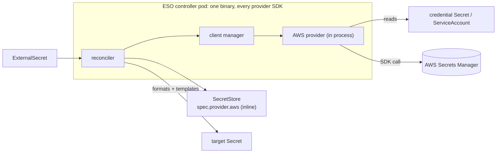
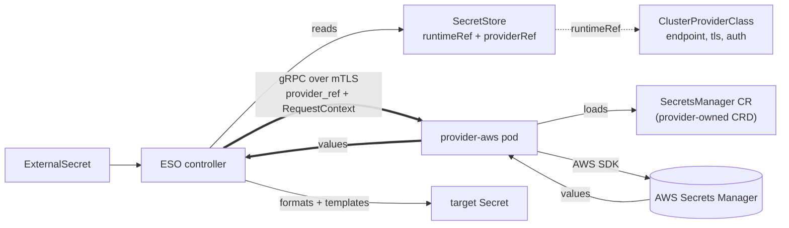
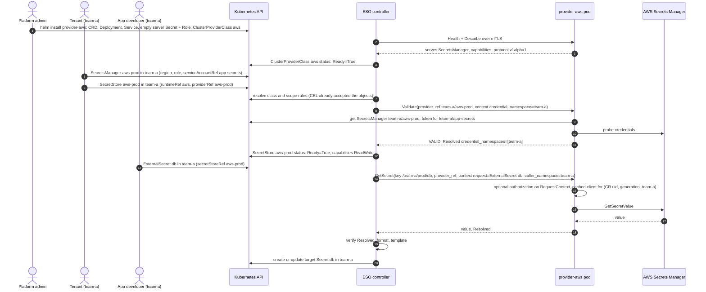

## Summary

Separate Out of Tree Providers via dedicated Custom Resources for them.
Providers are deployed separately from core ESO, and reconcile a dedicated CRD group
for that provider. New Core-Related CRDs are added for ESO to know where a provider is,
and how to communicate with it.

Minimal manifests for the simple case are in [`examples/`](./examples/): a
`ClusterProviderClass`, a provider-owned `SecretsManager` configuration and a
`SecretStore` that points at both. `ExternalSecret` and `PushSecret` do not
change.

By moving provider configuration to a GVK Reference under `providerRef`, this allows
providers to not even be on the same Kubernetes Cluster as ESO - as long as they can
translate a `providerRef` GVK into some internal config that might live in memory,
in a database, in another kubernetes cluster, etc.

### Today: providers compiled into the controller

### Afterwards: providers as separate processes behind a gRPC contract

### Who creates what, and what happens

