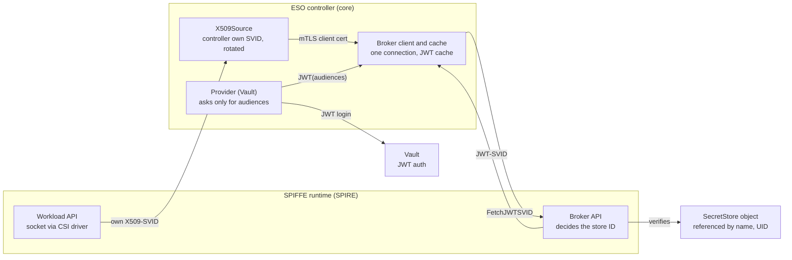

# Design: SPIFFE Broker API integration in External Secrets Operator

Nov 26, 2026 · @JP

```yaml
---
title: SPIFFE Broker API Integration
version: v1alpha1
authors: TBD
creation-date: 2026-11-26
status: draft
---
```

## Summary

SecretStores and ClusterSecretStores get their own SPIFFE identity, which providers use to authenticate to backends without a stored credential or a ServiceAccount token.

The controller acts as a SPIFFE Broker. It authenticates to the SPIFFE Broker API with its own X509-SVID, asks for a JWT-SVID on behalf of a store object, and hands that token to the provider. The provider exchanges it with the backend exactly as it exchanges a ServiceAccount token today.

The change is small by design:

- One shared gRPC connection in the controller, started only when the deployer configures it. No per-store goroutines.
- One narrow interface in `runtime`, with the implementation and its dependencies kept in the core module.
- One optional CRD field per provider auth block, added provider by provider, starting with Vault and OpenBao JWT auth.

The design follows what Flux shipped in 2.10 (RFC-0014), adapted to ESO's module layout and tenancy model.

## Motivation

ESO removes static secrets from workloads, yet most stores still start from one: a token or key in a Kubernetes Secret, or a ServiceAccount token minted by the controller.

SPIFFE gives each store a short-lived identity issued by the platform's identity runtime. The SPIFFE Broker API, merged into the SPIFFE standard in June 2026, is the piece that makes this possible for a controller. It lets an authorized component fetch SVIDs for Kubernetes objects that are not running processes, such as a SecretStore.

Flux adopted it in 2.10 for the same reason. ESO closed an earlier SPIFFE/SPIRE request ([#6235](https://github.com/external-secrets/external-secrets/issues/6235)) as stale; the Broker API gives that request a standard foundation.

### Goals

1. A SecretStore or ClusterSecretStore can declare that it authenticates with its own SPIFFE identity.
2. The identity is a JWT-SVID fetched through the SPIFFE Broker API, with the store object as the reference.
3. Providers consume the token through one small interface and never import SPIFFE or gRPC code.
4. The feature is off unless the deployer configures it, and costs nothing when off.
5. The design survives the move to out-of-process providers in v2 without a second redesign.

### Non-Goals

- **X509-SVIDs for stores.** These need Broker API streams and a subscription manager. Deferred.
- **Using the controller's own identity against backends.** The controller's SVID is for mTLS to the broker only.
- **Per-ExternalSecret identities.** Stores are the identity boundary.
- **Replacing ServiceAccount token auth.** It stays supported; some backends accept nothing else.
- **Generators.** They have no store, so they need a separate subject decision.
- **Controller-to-provider-runtime authentication in v2.** That is a separate concern from the Broker API.
- **Deploying or configuring SPIRE.** ESO consumes an existing SPIFFE runtime.

## Proposal

### High-level design

Two identities are involved, and they never mix: the controller's own SVID opens the channel to the broker, and the store's SVID is what the backend sees.



Providers never reach the SPIFFE runtime. They ask core for a token, and core is the only party that holds a connection to the Broker API.

The request path for one store:

1. At startup, core obtains its own X509-SVID from the SPIFFE Workload API. go-spiffe's `X509Source` keeps it rotated.
2. Core opens one mTLS gRPC connection to the Broker API endpoint and authorizes the server against the configured broker SPIFFE IDs.
3. On reconcile, the client manager binds a store-scoped identity handle to the context before it calls the provider's `NewClient`.
4. The provider asks the handle for a JWT with the audiences from the store spec.
5. Core serves it from cache, or calls `FetchJWTSVID` with a `KubernetesObjectReference` for the store: group, resource, namespace, name and UID.
6. The SPIFFE runtime checks that the controller may act for that object, resolves the object's SPIFFE ID, and returns a JWT-SVID.
7. The provider exchanges the JWT with the backend (Vault JWT login, later AWS STS) and proceeds as today.

The SPIFFE runtime decides which SPIFFE ID a store receives. ESO sends a reference and has no say in the result. Tenancy is therefore enforced in the runtime's registration and authorization, with the store's namespace as the boundary.

### User Stories

- **Platform admin.** I run SPIRE and want ESO stores to authenticate to Vault with SPIFFE identities, so no Vault credential lives in the cluster and I control identities in one place.
- **Tenant.** I own a namespace and a SecretStore. I add `spiffe` to its auth block and get an identity scoped to my store, without creating a ServiceAccount or a Secret.
- **Cluster operator.** I manage a ClusterSecretStore shared by several namespaces. It has one identity of its own, and the existing namespace conditions still decide who may use it.
- **Security reviewer.** I want the controller's own identity never to be presented to a backend, and I want to see which SPIFFE ID each store was issued.
- **Operator not using SPIFFE.** I upgrade ESO and nothing changes: no new connection, no new permission, no new dependency in provider binaries.

### API

**Shared type** in `apis/meta/v1`:

```go
// SPIFFEIdentity selects the store's own SPIFFE identity as the
// credential. The identity is a JWT-SVID fetched from the SPIFFE
// Broker API for the SecretStore or ClusterSecretStore object.
type SPIFFEIdentity struct {
    // Audiences for the JWT-SVID. At least one is required.
    // +kubebuilder:validation:MinItems=1
    Audiences []string `json:"audiences"`
}
```

**Vault and OpenBao** (phase 1), a new optional field on `VaultJwtAuth` next to `secretRef` and `kubernetesServiceAccountToken`:

```go
type VaultJwtAuth struct {
    Path string `json:"path"`
    Role string `json:"role,omitempty"`
    SecretRef *esmeta.SecretKeySelector `json:"secretRef,omitempty"`
    KubernetesServiceAccountToken *VaultKubernetesServiceAccountTokenAuth `json:"kubernetesServiceAccountToken,omitempty"`
    // +optional
    SPIFFE *esmeta.SPIFFEIdentity `json:"spiffe,omitempty"`
}
```

```yaml
apiVersion: external-secrets.io/v1
kind: SecretStore
metadata:
  name: team-a
  namespace: team-a
spec:
  provider:
    vault:
      server: https://vault.example.com
      path: secret
      auth:
        jwt:
          path: jwt
          role: team-a
          spiffe:
            audiences: [vault]
```

**AWS** (phase 2), the same type on `AWSJWTAuth`:

```yaml
auth:
  jwt:
    spiffe:
      audiences: [sts.amazonaws.com]
```

**Validation.** Each site gets a one-of rule: exactly one of `secretRef`, the ServiceAccount option, or `spiffe`.

**Status** (proposed, phase 3). The store publishes the SPIFFE ID it was last issued, so users can see the result of the runtime's decision:

```yaml
status:
  identity:
    spiffeID: spiffe://example.org/ns/team-a/secretstore/team-a
```

**Controller configuration.** No CRD involved:

| Setting | Purpose |
| --- | --- |
| `SPIFFE_ENDPOINT_SOCKET` (env) | Workload API socket, normally mounted through the SPIFFE CSI driver |
| `--spiffe-broker-endpoint` | gRPC target of the Broker API, for example `dns:///spire-agent.spire.svc:443` |
| `--spiffe-broker-id` (repeatable) | SPIFFE ID or ID prefix the broker server must present |

The feature is enabled when the endpoint and at least one broker ID are set. Flag names match Flux so operators running both see the same vocabulary.

**Compatibility.** All CRD additions are optional fields on existing v1 types. No version bump and no conversion are needed.

### Low-level design

The contract lives in `runtime` with no new dependencies; go-spiffe and gRPC stay in the core module. This respects `design/015-module-import-boundaries.md`, since every provider module imports `runtime`.

**Go modules touched**

| Module | Change | New dependencies |
| --- | --- | --- |
| `apis` | `meta/v1.SPIFFEIdentity`; optional `spiffe` field per provider auth block; later `status.identity` | None |
| `runtime` | New package `runtime/identity`: `Token`, `StoreIdentity`, context helpers | None (stdlib only) |
| core (`pkg`, `cmd`) | New package `pkg/spiffe`: broker client, cache, manager runnable. Flags. Client manager binds the handle | `go-spiffe/v2` (including `exp/proto/spiffe/broker`), `grpc`, `x/sync/singleflight` |
| `providers/v1/vault`, `openbao` | One new branch in JWT auth | None |
| Helm chart | Values for the flags, env and CSI volume | None |

**Contract: `runtime/identity`**

```go
package identity

// Token is a short-lived identity credential for a store.
type Token struct {
    Value     string
    ExpiresAt time.Time
}

// StoreIdentity mints credentials for one store. The subject is
// fixed by core when the handle is created; callers choose only
// the audiences.
type StoreIdentity interface {
    JWT(ctx context.Context, audiences []string) (Token, error)
}

// WithStore attaches a store-scoped handle to the context.
func WithStore(ctx context.Context, id StoreIdentity) context.Context

// FromContext returns the handle. When SPIFFE is not configured it
// returns a handle whose JWT method fails with ErrNotConfigured.
func FromContext(ctx context.Context) StoreIdentity

var ErrNotConfigured = errors.New("SPIFFE Broker API is not configured on the controller")
```

**Implementation: `pkg/spiffe` (core only)**

```go
package spiffe

type Config struct {
    BrokerEndpoint string   // --spiffe-broker-endpoint
    BrokerIDs      []string // --spiffe-broker-id
}

// Broker owns the controller's X509Source and the single gRPC
// connection to the Broker API. It implements manager.Runnable.
type Broker struct {
    x509  *workloadapi.X509Source
    conn  *grpc.ClientConn
    api   brokerpb.APIClient
    cache *tokenCache
    sf    singleflight.Group
}

func New(cfg Config) (*Broker, error)
func (b *Broker) Start(ctx context.Context) error // blocks until ctx is done, then closes

// For returns a handle bound to one store object.
func (b *Broker) For(store esv1.GenericStore) identity.StoreIdentity

// subject is private to core. Providers cannot construct one.
type subject struct {
    Group, Resource, Namespace, Name string
    UID types.UID
}
```

**Core wiring: `pkg/controllers/secretstore/client_manager.go`**

```go
if m.broker != nil {
    ctx = identity.WithStore(ctx, m.broker.For(store))
}
secretClient, err = storeProvider.NewClient(ctx, store, m.client, namespace)
```

This is the only `NewClient(ctx, ...)` call site found in `pkg`. Any other path that builds provider clients must bind the handle the same way.

**Provider change: `providers/v1/vault/auth_jwt.go`**

```go
if jwtAuth.SecretRef != nil {
    jwt, err = resolvers.SecretKeyRef(...)
} else if sa := jwtAuth.KubernetesServiceAccountToken; sa != nil {
    jwt, err = createServiceAccountToken(...) // unchanged
} else if jwtAuth.SPIFFE != nil {
    var tok identity.Token
    tok, err = identity.FromContext(ctx).JWT(ctx, jwtAuth.SPIFFE.Audiences)
    jwt = tok.Value
} else {
    err = errors.New(errJwtNoTokenSource)
}
```

**Broker call.** `FetchJWTSVID` is unary. Each call carries the `broker.spiffe.io: true` metadata header required by the endpoint specification. The reference is a `KubernetesObjectReference` with group `external-secrets.io`, resource `secretstores` or `clustersecretstores`, namespace (empty for cluster scope), name and UID.

**Caching**

- **Why.** Many ExternalSecrets share one store. Without a cache, a cold start sends one identical broker request per reconcile.
- **What.** The JWT-SVID itself. Backend credentials (Vault tokens, STS credentials) stay cached in providers as today.
- **Key.** Store group, resource, namespace, name and UID, plus sorted audiences. Two stores never share an entry, even if the runtime gives them the same SPIFFE ID.
- **Concurrency.** `singleflight` on the same key, so concurrent misses make one broker call.
- **Refresh.** An entry is served while more than 60 seconds of lifetime remain, matching `MinTokenBuffer` in `runtime/oidc`. Otherwise it is refetched.
- **Eviction.** On store deletion, on UID change, and on `PermissionDenied` or `NotFound` for that subject.
- **Storage.** Memory only. Nothing is written to a Secret or to disk.

### Behavior

- **Feature off.** No flags set: no Workload API connection, no broker connection, no goroutine. A store that sets `spiffe` becomes not ready with reason `SPIFFENotConfigured`.
- **Startup.** With flags set, the controller waits for its own X509-SVID with a bounded timeout. If the Workload API is unreachable, the controller fails to start rather than running half-configured.
- **Transient broker errors.** Retried with backoff under a 30 second cap per fetch, as Flux does.
- **Permanent errors.** `PermissionDenied`, `NotFound`, `InvalidArgument`, `Unauthenticated` and `Unimplemented` are returned immediately and surface as a store condition with the broker's message.
- **Store recreated.** A new UID is a new subject and a new cache key. The runtime verifies that name and UID match.
- **ClusterSecretStore.** One identity for the store, with an empty namespace in the reference. Namespace conditions on the store are unchanged.
- **Controller identity.** There is no fallback to the controller's own JWT-SVID when the broker is missing. Flux does fall back to the Workload API; ESO does not, because it would change whose identity the backend sees.

### Phasing

Each phase ships on its own and leaves the previous one working. Nothing in phases 1 to 3 depends on v2.

| Phase | Scope | Exit gate |
| --- | --- | --- |
| 0. Groundwork | Design accepted. An e2e environment with SPIRE and its experimental Broker API. Confirm how SPIRE registers and authorizes `secretstores` and `clustersecretstores` references | A JWT-SVID fetched for a SecretStore in a kind cluster, outside ESO |
| 1. Alpha: Vault and OpenBao | `runtime/identity`, `pkg/spiffe`, flags, client manager binding, `spiffe` on Vault and OpenBao JWT auth, Helm values, docs. Behind an alpha feature flag | e2e green for SecretStore and ClusterSecretStore against Vault JWT auth; no new dependency in any provider module |
| 2. More providers | AWS `auth.jwt.spiffe` after the fallback check below. Then other JWT-federation providers one at a time. Metrics | Each provider has its own e2e case and one-of validation |
| 3. Store status | status.identity.spiffeID: each store publishes the SPIFFE ID it was last issued | Issued ID visible on SecretStore and ClusterSecretStore, covered by e2e |
| 4. Aligned with v2 | Core stays the only broker client. Tokens reach out-of-process provider runtimes in the request, not through a context value. Optionally move ServiceAccount token minting behind the same interface | Decided in the v2 design, not here |
| Deferred | X509-SVIDs for stores, generators, a provider-initiated minting callback | Separate proposals |

**Why the interface survives v2.** In process, the handle travels in the context. Out of process, a context value cannot cross the boundary, so core fetches the token and sends it with the request. Providers see the same shape either way: a token for their store with the audiences they asked for. Only the transport changes.

**Why core stays the only broker.** Broker authorization is the most powerful permission in this design, because it lets the holder request identities for other objects. Giving it to every provider runtime would spread it across many processes. With core as the sole broker, a provider process only ever receives tokens for stores it serves.

**ServiceAccount minting, later and optional.** Today providers mint ServiceAccount tokens themselves, each with its own Kubernetes client. A second `StoreIdentity` implementation could serve those tokens through the same call:

```go
src, err := identity.For(ctx, jwtAuth) // SPIFFE or ServiceAccount
tok, err := src.JWT(ctx, audiences)
```

The feature and its CRD fields would not change, only where the minting code lives. It is a refactor of working code, SPIFFE does not need it, and it belongs with the v2 work.

### Drawbacks and risks

The largest risk is that the controller becomes a broker: it can ask for the identity of any object the SPIFFE runtime lets it act for.

| Risk | Impact | Mitigation |
| --- | --- | --- |
| Controller holds broker authorization | A compromised controller can request identities for every store it is authorized for | The runtime's authorization is the real boundary. Document least-privilege setup: SPIRE's `impersonate-via-spire` RBAC verb, scoped to the two store resources. Core is the only broker client |
| No in-process isolation between providers | The bound handle stops accidental misuse, such as building the wrong subject. It does not stop a malicious or compromised provider, which shares the controller's address space and Kubernetes client | State this plainly in docs. Do not present the handle as a security boundary. Real separation arrives with out-of-process providers in v2 |
| SPIRE's Broker API is experimental | Breaking changes upstream; go-spiffe bindings live under `exp/` | Alpha feature flag. Pin go-spiffe. Keep all broker code in one package so a protocol change touches one place |
| Version skew on the AWS path | An older controller ignores `spiffe`. With `jwt: {}` it might fall back to the pod's own credentials. Not verified | Verify before phase 2. If confirmed, add validation or a guard so the store fails instead of falling back |
| Admission and controller disagree | CRDs and webhook validate `spiffe` while the controller has no broker configured | Store goes not ready with `SPIFFENotConfigured`; never a silent fallback |
| New hard dependency at startup | With flags set, a Workload API outage blocks controller start | Bounded wait and a clear error. The feature stays opt-in |
| Broker outage at runtime | Stores using `spiffe` cannot refresh once cached tokens expire | Cache covers short outages. Retries with backoff. Metrics and a store condition make it visible |
| Context value as a dependency carrier | Less explicit than a parameter, and it does not cross a process boundary | Chosen to avoid changing about 40 `NewClient` implementations. Revisit at the next provider API version |
| Identity is invisible in the spec | A store author cannot tell from the manifest which SPIFFE ID they get | Publish the issued ID in store status (phase 3) |
| Dependency growth in core | go-spiffe and gRPC are added to the core module | Confined to core. Provider modules gain nothing |
| Registration cardinality | One SPIFFE registration per store, managed by the platform team | Stores are the subject, not ExternalSecrets, which keeps the count low. Templated registrations are a runtime feature |

**Drawbacks that remain.** Operators must run a SPIFFE runtime with the Broker API, mount the Workload API socket into the ESO pod, register the controller, and authorize it as a broker. That is real setup work, and SPIRE is the only runtime this design has been checked against.

### Acceptance Criteria

**Rollout and rollback**

- Alpha behind a feature flag, off by default. Enabling needs the flag, the two broker settings and the Workload API socket.
- Rollback is removing the flags and switching stores back to `secretRef` or a ServiceAccount token. No data migration exists in either direction.
- CRD fields are additive. Downgrading the controller while stores still set `spiffe` is the skew case listed under risks.

**Test roadmap**

- Unit: cache keying, refresh and eviction; singleflight under concurrent misses; error classification; reference encoding for both store kinds; one-of validation.
- Integration: a fake Broker API server over mTLS, covering retries, `PermissionDenied`, and reconnect after the server restarts.
- e2e: kind with SPIRE and Vault. SecretStore and ClusterSecretStore with `spiffe`; store recreated with a new UID; controller started without flags while a store sets `spiffe`.
- Dependency check: provider modules do not gain go-spiffe or gRPC.

**Observability and monitoring**

- Metrics: broker fetch count and latency by result code, cache hits and misses, connection state, and seconds until the controller's own SVID expires.
- Store conditions with distinct reasons: `SPIFFENotConfigured`, `SPIFFEPermissionDenied`, `SPIFFEBrokerUnavailable`.
- Events on the store when a fetch fails permanently.
- Example alerts: sustained broker fetch failures; controller SVID close to expiry.

**Troubleshooting**

| Symptom | Likely cause | Where to look |
| --- | --- | --- |
| Controller does not start with flags set | Workload API socket missing, or no registration for the controller | Controller log, CSI volume mount, runtime registration entries |
| TLS handshake to broker fails | `--spiffe-broker-id` does not match the server's SPIFFE ID | Controller log shows the presented ID |
| Store not ready, `SPIFFEPermissionDenied` | Controller is not authorized for that store, or the store is not entitled to an identity | Runtime authorization (RBAC verb) and registration for the object |
| Store ready, backend rejects the token | Audience or role mismatch on the backend | `spiffe.audiences`, backend JWT auth config, issued ID in store status |
| Works for SecretStore, not ClusterSecretStore | Registration or authorization covers only the namespaced resource | Runtime configuration for `clustersecretstores` |

## Alternatives

The chosen design sits between the two approaches first considered: a shared client in the controller, consumed by providers through an interface.

| Alternative | For | Against | Outcome |
| --- | --- | --- | --- |
| Provider-driven `spiffe` runtime module, each provider talking to the broker | Simple to start; no core change | Each provider owns a connection, cache and trust configuration. go-spiffe and gRPC enter every provider module. Broker authorization is spread out | Rejected |
| Controller-level manager with a goroutine per identity | Needed for streaming X509-SVIDs | Unnecessary for JWT, where the fetch is unary. More lifecycle code than the problem needs | Deferred with X.509 |
| ServiceAccount annotations, as Flux does | No CRD change | Untyped and unvalidated. Flux needed them to retrofit `serviceAccountName`; ESO has typed auth blocks and needs no ServiceAccount here | Rejected |
| A `source` field on `ServiceAccountSelector` | Reaches all 25 usage sites at once | `name` is required there and means nothing for SPIFFE. Confuses two concepts | Rejected |
| Store-level `spec.identity` | One place in the CRD | Ambiguous for providers with several auth methods | Rejected |
| ServiceAccount as the broker reference | Mirrors existing `serviceAccountRef` semantics | Adds an object that carries no information. The store is what holds the backend relationship | Rejected |
| ExternalSecret as the subject | Finest-grained identity | Multiplies registrations and cache entries. The provider never sees the ExternalSecret | Rejected |
| Controller's own JWT-SVID from the Workload API | No broker needed | One identity for all tenants. Violates the declared-identities rule | Rejected |
| Package-level default (`SetDefault`) for the handle | No signature change | Global state; awkward in parallel tests; hands providers an unbound source | Rejected in favor of context |
| Extra parameter on `NewClient` | Explicit dependency | Changes about 40 in-tree implementations and every out-of-tree provider | Revisit at the next provider API version |
| `expectedID` on the store | Catches misregistration at the client | A spec field to keep in sync; adds no security since the backend validates | Replaced by publishing the issued ID in status |
| A generator that writes JWT-SVIDs into Secrets | Reuses an existing mechanism | Materializes the credential this design avoids storing | Rejected |
| Sidecar or `spiffe-helper` writing files | No code in ESO | Single identity, plus file plumbing | Rejected |

## Decisions and next items

These were settled in the design discussion on 26 November 2026 and are the basis for everything above.

| # | Decision | Reason |
| --- | --- | --- |
| 1 | Hybrid design: a shared broker client in core, consumed by providers through an interface | Keeps one connection, one cache and one trust configuration, while providers stay in charge of their backend exchange |
| 2 | The interface lives in `runtime`; the implementation lives in core | Provider modules import `runtime`, so it must not gain go-spiffe or gRPC |
| 3 | Unary JWT-SVID first | No managing goroutine is needed. A shared connection and a cache are enough |
| 4 | X509-SVIDs for stores are deferred | They need Broker API streams and a subscription manager |
| 5 | The controller's X509-SVID is used only for mTLS to the broker | The Broker endpoint requires it. It is never presented to a backend |
| 6 | Declared identities only; no controller-identity source | Whose identity a backend sees must be explicit in the store |
| 7 | The store object is the subject, for SecretStore and ClusterSecretStore | Stores hold the backend relationship. ExternalSecrets as subjects would multiply identities |
| 8 | A ClusterSecretStore has its own single identity | Tenants who need their own identity use a namespaced SecretStore |
| 9 | A typed `spiffe` field per provider auth block | Additive, validated, and can land one provider at a time |
| 10 | Vault and OpenBao first, then AWS | Vault JWT auth has the simplest exchange and fails safely under version skew |
| 11 | The handle is carried in the context and bound to one store by core | No change to `NewClient`, no global state, and providers cannot name another subject by mistake |
| 12 | The bound handle is hygiene, not a security boundary | Providers share the controller's process. The runtime's authorization is the boundary today |
| 13 | Core is the only broker client, now and in v2 | Keeps broker authorization in one process |
| 14 | ServiceAccount token auth stays | Users depend on it and some backends require it. Moving its minting code is optional and tied to v2 |
| 15 | Publish the issued SPIFFE ID in status instead of an `expectedID` spec field | Same visibility without a field to keep in sync |
| 16 | Controller-to-runtime authentication and a provider-initiated minting callback are out of scope | Both belong to the v2 design |

**Next items**

- [ ] Confirm with SPIRE how a `secretstores` or `clustersecretstores` reference is registered and authorized, including the exact RBAC for `impersonate-via-spire`.
- [ ] Verify the AWS behaviour when `auth.jwt` is set without `serviceAccountRef` on a controller that does not know `spiffe`.
- [ ] Audit core for every path that builds provider clients, so each binds the handle.
- [ ] Decide the feature flag name and how it fits `design/014-feature-flag-consolidation.md`.
- [ ] Decide the Helm values shape for the socket volume, env and flags.
- [ ] Confirm the status field name; it lands in phase 3.
- [ ] Build the e2e environment: kind, SPIRE with the Broker API enabled, Vault with JWT auth trusting SPIRE's JWT bundle.
- [ ] Write the operator guide: registration for the controller, broker authorization, least-privilege setup.
- [ ] Carry decisions 13 and 16 into the v2 design so the token transport is defined there.
- [ ] Open the design PR as `design/016-spiffe-broker-api.md` and set the authors field.

## Sources

- [SPIFFE Broker API specification](https://spiffe.io/docs/latest/spiffe-specs/spiffe_broker_api/)
- [SPIFFE Broker Endpoint specification](https://spiffe.io/docs/latest/spiffe-specs/spiffe_broker_endpoint/)
- [SPIRE Agent configuration reference, Broker API section](https://spiffe.io/docs/latest/deploying/spire_agent/)
- [Flux RFC-0014: Advanced Support for Short-Lived Cryptographic Material](https://github.com/fluxcd/flux2/tree/main/rfcs/0014-advanced-support-for-short-lived-cryptographic-material)
- [Flux `pkg/spiffe/brokerapi`](https://github.com/fluxcd/pkg/tree/main/spiffe/brokerapi) and [`pkg/auth/access_credential.go`](https://github.com/fluxcd/pkg/blob/main/auth/access_credential.go)
- [Flux Object Identity API](https://fluxcd.io/flux/integrations/object-identity/) and [Flux 2.10 announcement](https://fluxcd.io/blog/2026/10/flux-v2.10.0/)
- [ESO design template](https://github.com/external-secrets/external-secrets/blob/main/design/000-template.md) and [module import boundaries](https://github.com/external-secrets/external-secrets/blob/main/design/015-module-import-boundaries.md)
- ESO source read at `main` on 26 November 2026: `apis/externalsecrets/v1/provider.go`, `secretstore_vault_types.go`, `secretstore_aws_types.go`, `pkg/controllers/secretstore/client_manager.go`, `providers/v1/vault/auth_jwt.go`, `runtime/oidc/token_manager.go`
